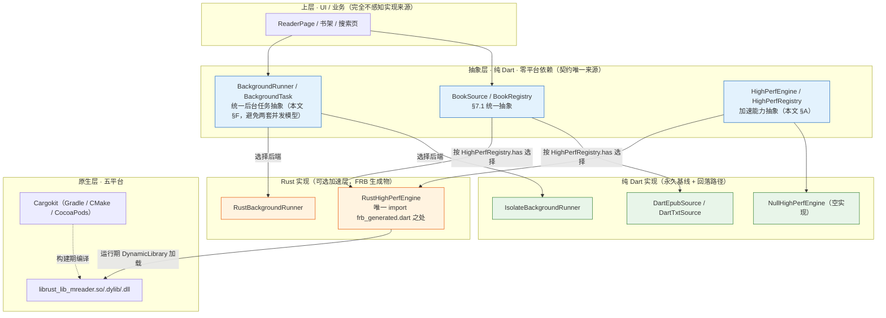
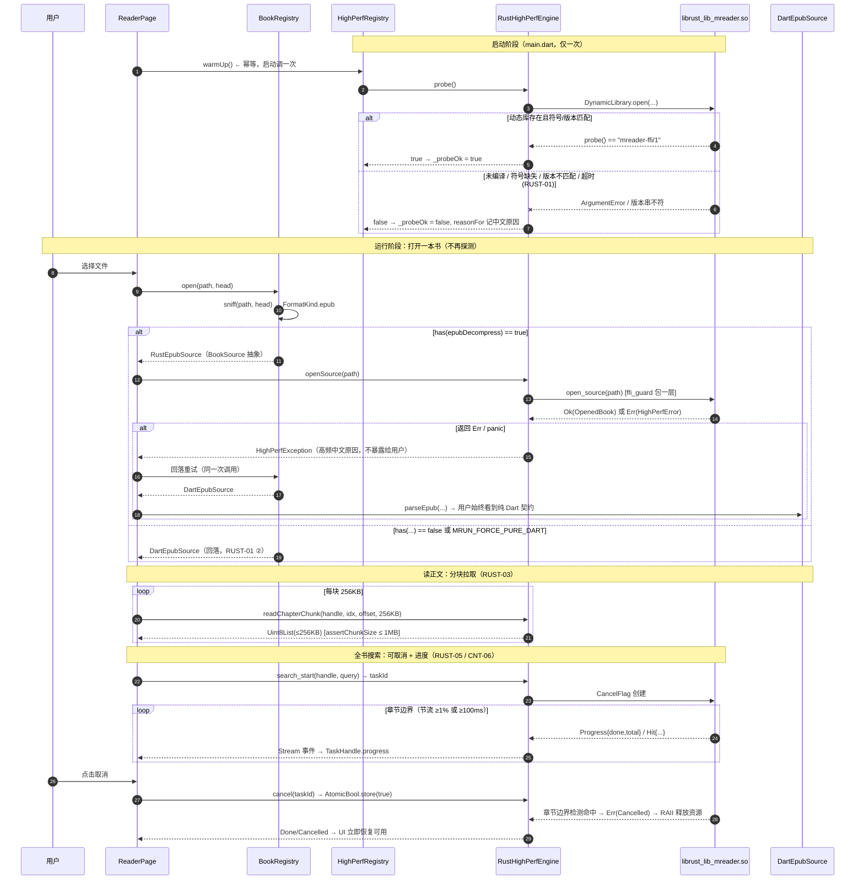

# 阅读M（MReader）· Rust 高性能能力层集成架构设计

> **文档类型**：架构设计 + 任务分解（施工依据，非原则性论述）
> **作者**：架构师 高见远（software-architect）
> **依据**：`docs/PRD.md` v2.4（1664 行）· §7.1 / §7.2 / §13.1 / §13.3 `NF-C8` / §13.4 `NF-D8` / §15.1 / §15.3 / §15.4 / §15.5 / §15.5.1 / **§15.6 全节** / §6.3 `RUST-01~10` / §16 `Q19~Q23` / §17 `M3.5`
> **编号对齐**：本设计的每一节都与 PRD 的 `RUST-01~10` 显式对齐；**功能契约一律以 PRD 为准**，本文只定「怎么落地」。
> **事实标注约定**：【事实】= 本次实测 / 查证（附可复核 URL）；【推断】= 作者判断。

---

## 0. 结论速览（先看这 8 条）

| # | 问题 | 结论 |
|---|---|---|
| 1 | `lib/source/capability/` 那套形制复用还是另立？ | **另立目录 `lib/highperf/`，但严格照搬其形制**（接口 + 注册表 + 空实现回落 + 幂等 `warmUp` 探测 + `reasonFor`）。理由见 §A.4——书源功能已排除、`lib/source/**` 属待删原型，且 `Capability`/`ScriptCapability` 的语义域是 JS 求值，与格式解析域不同。 |
| 2 | MOBI/AZW3 在 Rust 生态有现成 crate 吗？ | **有。`mobi` 0.8.0（MIT · 纯 Rust）完整实现了 HUFF + CDIC 解压**（源码含 `src/compression/huff.rs`，函数 `load_huff` / `load_cdic_record` / `unpack` 均已实证）。**PRD「需移植算法」这一隐含前提在 Rust 侧不成立**——但该 crate **3.9 年未更新**，且**未声明 KF8/AZW3 双格式边界支持**。详见 §I.6。 |
| 3 | FRB 2.13.x 的 MSRV 与 rustc 1.89.0 匹配？ | **匹配，且余量极大**。FRB 2.13.0 的 `rust-version = "1.70.0"`【事实，crates.io API】，本机 rustc 1.89.0【事实，本次实测】。**注意：本机已装 codegen 是 2.12.0，非 PRD 所写的 2.13.x**（§G.4）。 |
| 4 | Cargokit 与 Flutter **3.47.5** 匹配？ | **官方已有对 Flutter ≥3.32 的修复（`irondash/cargokit` PR #118），3.47.5 理论上适用，但未被任何公开记录在该版本上验证过**【事实】（**2026-09-28 版本更正**：原问 3.44.9；项目已于 2026-09-24 升至 **3.47.5 / Dart 3.13.4**，**离已知修复边界 3.32 更远**，故原判断「理论上适用」的把握**只降不升**）。**必须走 `Q20` 最小通路验证，验证不过则整条 Rust 线回退纯 Dart**（§G.2）。 |
| 5 | 「无 Rust 仍可构建」选哪种机制？ | **运行期 `try/catch` 加载动态库**。理由：五平台都有 `dart:ffi`，**条件导入（`if (dart.library.ffi)`）的编译期分支在五平台恒为真，根本无法区分「有 ffi 但 .so 缺失」**——它解决不了本问题。原生构建侧用「平台构建脚本 guard」，见 §G.3。 |
| 6 | 等价性判定定义 | **三层字节级 / 字符串级严格相等**：① 章节骨架（归一化 href 序列 + 数量）② 正文块（`title + paragraphs` 字符串序列逐条 `==`）③ 元数据（title/author/language + 封面字节 + 来源标记）。**允许不等价的仅：耗时、内部句柄 id、搜索命中顺序（集合必须相等）、错误文案措辞（错误**类别**必须相等）**。见 §B.1。 |
| 7 | `panic = "abort"` 处置 | `rust/Cargo.toml` 的 `[profile.dev]`/`[profile.release]` 均**显式** `panic = "unwind"`；并加一道**机械护栏测试** `test/rust_profile_guard_test.dart`（读 Cargo.toml，出现 `panic = "abort"` 即 fail）。见 §D.2。 |
| 8 | 阈值测量协议要点 | 纯 Dart 基线：`Stopwatch` 从「bytes 已在内存」开始计时（**不含 IO、不含渲染**），**N=7 取中位数**，同时记 min/max；**Android 主力机为唯一判定基准**，桌面端只记录不判定；**10% 死区**规则处理「780ms vs 800ms」这类临界。见 §H。 |

> **对 PRD 的一处纠错（不改 PRD，回报主理人转交）**：
> PRD §15.4 / §15.6.5 写「`flutter_rust_bridge`（v2 版本线，**当前稳定 2.13.x**）」，本机实测 codegen 为 **2.12.0**；且 crates.io 上 2.13.0 才是当前稳定版。**建议实施时统一升级到 2.13.0**（同版本线，API 兼容），或把 PRD 措辞改为「2.x（实施时锁定具体版本）」。见 §L。
> 另：PRD §15.2 提到 `lib/web/`，**本仓库实际不存在 `lib/web/` 目录**（只有根目录 `web/`）。清理清单据此调整，见 §K。

---

## 1. 分层与挂载总图



**分层铁律（对应 §15.1 控制措施）**：

1. `抽象层` 只依赖自己的类型，纯 Dart、零 Flutter、零 FFI。`lib/highperf/` 根目录下**禁止** `import 'package:flutter_rust_bridge/...'`。
2. 只有 `lib/highperf/ffi/high_perf_ffi_engine.dart` 允许 import FRB 生成物（`lib/src/rust/**`）——这是**唯一缝**，可被静态检查。
3. `BookSource` 各实现（Dart / Rust）**互不感知**：选择发生在 `BookRegistry`，实现类之间没有任何 import。
4. 新增格式只新增 `BookSource` 实现 + 在 `BookRegistry` 注册 → **不改 `ReaderPage`**（兑现 §7.1「新增格式不得修改阅读器代码」）。

---

## A. 挂载点与分发机制（对应 `RUST-01`）

### A.1 抽象定义（真实代码，Dart 侧）

```dart
// §7.1 统一抽象（纯 Dart，不 import Flutter、不 import dart:io）。
// 实施落位（M1-T02）：类型已拆到多个文件、由 `lib/format/book_source.dart` 统一 `export` ——
// 见下方 §A.1.1「文件落位」。此处按**契约**合并展示，import 路径以 §A.1.1 为准。

/// 书籍元数据（含来源标记，对应 META-01）。
class BookMeta {
  const BookMeta({
    required this.title,
    required this.author,
    required this.language,
    required this.coverBytes,
    required this.titleOrigin,
    required this.authorOrigin,
    required this.coverOrigin,
  });
  final String title;
  final String author;
  final String language;
  final Uint8List? coverBytes;
  /// 来源标记（`META-01`）：**闭合四值**（`metadata` / `filename` / `user` / `none`）。
  /// ⚠️ 本代码块是 **M1-T02 的过渡形态**（裸 `String`；`coverBytes` 尚未改为 `CoverRef`；缺 `intro`）。
  /// 旧注释曾写作 `'opf:dc:title' / 'exth:100'`——那是「**哪一路内嵌源**」，属**另一根轴**，
  /// **不是** META-01 的四值，**已纠正**。**冻结形态见 §N（`MetaOrigin` 枚举 + `CoverRef` + `intro`）。**
  final String titleOrigin;
  final String authorOrigin;
  final String coverOrigin;
}

/// 章节定位信息。
class Chapter {
  const Chapter({
    required this.href,
    required this.title,
    required this.level,
    required this.locate, // 章内定位（如 fragment '#id'），无则空串
  });
  final String href;
  final String title;
  final int level;
  final String locate;
}

/// 正文内容：段落序列 或 图片页序列（互斥）。
class ChapterContent {
  const ChapterContent.paragraphs(this.paragraphs) : imagePages = null;
  const ChapterContent.imagePages(this.imagePages) : paragraphs = null;
  final List<String>? paragraphs;
  final List<String>? imagePages;
}

/// 本格式支持哪些能力。
class SourceCapabilities {
  const SourceCapabilities({
    required this.hasImages,
    required this.hasFootnotes,
    required this.reflowable,
    required this.searchable,
    required this.charCountSupported, // STAT-14 用
  });
  final bool hasImages;
  final bool hasFootnotes;
  final bool reflowable;
  final bool searchable;
  final bool charCountSupported;
}

/// §7.1 格式解析统一抽象。**所有实现互不感知**，由 BookRegistry 分发。
abstract class BookSource {
  /// 实现标识：'dart-epub' / 'rust-epub' / 'dart-txt' / 'rust-txt' …（仅日志/体检用）。
  String get implId;

  Future<BookMeta> load();
  Future<List<Chapter>> chapters();
  Future<ChapterContent> content(int chapterIndex);
  SourceCapabilities capabilities();

  /// 全书搜索（CNT-06）。**可取消、可进度回报**（RUST-05）。
  Stream<SearchEvent> search(String query, {required CancelToken cancel});

  /// 全书字符总数（`STAT-14` 用）；不支持时返回 `null`。
  ///
  /// **这是对 §A.1 的显式增补（M1-T02 实施后补入）**：PRD `STAT-14` 要求「字符数来自
  /// `BookSource.capabilities()` 暴露的**全书字符总数**」，而最初的 §A.1 只列了
  /// `charCountSupported` 布尔量——布尔量承载不了这条需求。故以**带默认实现**的方法补入
  /// （默认 `=> null`），不破坏既有字段与签名。
  /// 口径：EPUB 侧 = 全书段落 `paragraph.length` 之和；TXT 侧 = 全文非空白 code unit 数；
  /// **两口径的统一属 M2b（`STAT-14`）**。
  Future<int?> totalCharCount() async => null;

  /// 释放底层资源（句柄 / isolate / 文件）。
  Future<void> dispose();
}

/// 取消令牌（统一后台任务抽象的一部分，见 §F）。
class CancelToken {
  bool _cancelled = false;
  bool get isCancelled => _cancelled;
  void cancel() => _cancelled = true;
}
```

```dart
// lib/format/book_registry.dart —— 装配 + 分发点（本文 §A.2）
import 'book_source.dart';
import '../highperf/high_perf_registry.dart';
import '../highperf/high_perf_capability.dart';

class BookRegistry {
  /// [highPerf] 由 main.dart 注入；缺省 [HighPerfRegistry.fallback]（= 空实现 → 全纯 Dart）。
  BookRegistry({HighPerfRegistry? highPerf, Map<String, String>? extraUnavailable})
      : _hp = highPerf ?? HighPerfRegistry.fallback();

  final HighPerfRegistry _hp;

  /// 按一级（扩展名）+ 二级（魔数）分发（§7.3）；**按探测结果择实现**。
  /// 返回的一定是 [BookSource] 抽象——调用方无法、也无需知道来源。
  ///
  /// **签名以 M1-T02 实施为准**：`open({fileName, bytes})` 收**全量字节**（不是路径 + 头部）——
  /// 因为 `lib/format/**` **禁 `dart:io`**（`PERF-01` 把解析丢 isolate 的前提），
  /// 且 `file_picker` 统一 `withData: true`。实施签名见 §A.1.1。
  Future<BookSource> open({required String fileName, required Uint8List bytes}) async {
    final FormatKind kind = sniffFormat(fileName: fileName, bytes: bytes);
    switch (kind) {
      case FormatKind.epub:
        // M3.5：探测通过则改走 RustEpubSource（路径型，见下方 RUST-03 衔接）
        return _hp.has(HighPerfCapability.epubDecompress)
            ? RustEpubSource(fileName: fileName)   // ← Rust 实现（路径型）
            : DartEpubSource(fileName: fileName, bytes: bytes); // ← 回落（字节型）
      case FormatKind.txt:
        return _hp.has(HighPerfCapability.txtChapterize)
            ? RustTxtSource(fileName: fileName)
            : DartTxtSource(fileName: fileName, bytes: bytes);
      case FormatKind.unsupported:
        throw const MReaderFormatException(FormatErrorCode.unsupportedFormat);
      // … 将来 mobi / cbz / pdf …
    }
  }
}
```

> **`RUST-03` 衔接说明（写死，避免 M3.5 误判为签名冲突）**：`RUST-03` 要求**大文件跨 FFI 走「路径 / 句柄」**——这与 Dart 源**吃 bytes** 不冲突，两者是**不同层**：
> - **纯 Dart 源（`DartEpubSource` / `DartTxtSource`）吃 bytes**：因为 `lib/format/**` 禁 `dart:io`，字节由调用方一次性读入（`file_picker` `withData: true`）后传入，整个对象可直接丢 `compute()`。
> - **M3.5 的 Rust 源（`RustEpubSource` / `RustTxtSource`）收路径**：在 Rust 侧自持文件句柄，正文按 §C.3 分块拉取——这是 `RUST-03` 的落地形态。
> - `BookRegistry.open` 在 M3.5 按 `HighPerfRegistry` 探测结果，在「**bytes 型 Dart 源**」与「**路径型 Rust 源**」之间**择一**。届时 `open` 需要同时拿到 `fileName` 与 `bytes`（现在已是），**无需改签名**——两条路的能力都已在参数里。

> **注意命名冲突（已消解）**：现有 `lib/source/book_source.dart` 是 **legado 书源模型**，与 §7.1 的格式解析器同名。**书源功能已整体排除**（§14.2），`lib/source/**` 属待删原型 → 该名字将被释放。本设计把格式解析抽象落在**新目录 `lib/format/`**，与待删目录物理隔离，避免依赖一个即将删除的目录。（M0 工程整理批已实际删除 `lib/source/**`。）

### A.1.1 文件落位（M1-T02 实施后）

上面的代码块按**契约**合并展示；实际实施按 `docs/schedule.md` §2.1 的 M1-T02 行拆成**多文件**：

| 文件 | 内容 | 依赖纪律 |
|---|---|---|
| `lib/model/chapter.dart` | `Chapter` | **叶子**：不 import 任何东西 |
| `lib/model/chapter_content.dart` | `ChapterContent`（段落 / 图片页互斥） | 纯数据 |
| `lib/format/book_source.dart` | `BookMeta` / `SourceCapabilities` / `CancelToken` / `SearchHit` / `SearchEvent` / `BookSource` 抽象 | **只放「纯类型 + export」，不得 import 任何具体实现**（铁律第 3 条） |
| `lib/format/book_registry.dart` | `FormatKind` / `sniffFormat` / `BookRegistry` / `openBook` | 唯一允许 import 各实现的**分发点** |
| `lib/format/error_messages.dart` | `FormatErrorCode` / `MReaderFormatException` / `kFormatErrorMessages` | 面向用户中文文案的**唯一来源**（`RD-05` / `RUST-04 ②`） |

**`book_source.dart` 的 export 关系**（保证既有 import 路径不破）：
```dart
export 'error_messages.dart';
export '../model/chapter.dart';
export '../model/chapter_content.dart';
```
→ 因此实现方 `import 'book_source.dart';` 即可拿到 `Chapter` / `ChapterContent` / `MReaderFormatException`，**不必**逐个 import。

> **⚠️ 传承教训：`Chapter` 是全项目唯一的「章节」类型。**
> `Chapter` 位于 `lib/model/chapter.dart`（**叶子，不 import 任何东西**），`lib/epub/**`（目录解析）与 `lib/format/**`（各格式实现）**共用它，不得再复制第二份**。
> 本项目已经吃过一次亏：`EpubTocEntry` 与 `Chapter` 曾被定义成**结构相同的两份**，导致无意义的字段搬运与「各实现各自挑类型」，**已裁决合并**（commit `f22891b`）。元数据（M1-T05）与后续任何新模型**都会重演同样的陷阱**，因此把这条写死：**新增类型前先搜 `lib/model/`，能共用就共用**。

### A.2 探测时机与结果缓存

| 项 | 约定 | 理由 |
|---|---|---|
| 探测何时做 | **启动时一次**：`main()` 里 `await highPerf.warmUp()`（与既有 `CapabilityRegistry.warmUp()` 同一形制，同一位置） | §A.4 复用形制；`RUST-01 ③`「探测只做一次（不每次调用都探测）」 |
| 结果存哪 | `HighPerfRegistry` 实例字段 `bool? _probeOk`（三态）；**不引入可变全局单例** | 与 `capability_registry.dart` 的显式偏离一致：本项目不用 Riverpod/Provider，需要 registry 的地方一律构造注入 |
| 幂等 | `warmUp()` 已探测（`_probeOk != null`）则直接返回 | 抖动探针不会把结论翻回来（与 `capability_registry.dart` 语义一致） |
| 硬超时 | `probeTimeout = Duration(seconds: 3)` | 加载 `dlopen` + 一次轻量版本调用，正常毫秒级；3s 已是宽裕上限，超时即判死。**比 JS 引擎的 5s 短**——Rust 是本地库加载，无解释器初始化成本 |
| 探测成本 | ≈ 1 次 `DynamicLibrary.open` + 1 次符号解析 + 1 次 `probe()`（返回版本串，**不读任何书、不分配大内存**） | 打开书**不再探测**，无 IO 成本 |
| 结果缓存失效 | **进程内永久**；不因启用了什么书而变化 | 动态库可用性在进程生命周期内不会变（RUST-10 的强制开关是**显式**的，见 A.5） |

### A.3 探测失败的 5 种情形：判定与处置

> 这是 `RUST-01 ①`「删掉 / 改名 Rust 动态库后启动 App，全部功能可用、无崩溃」与 `RUST-01 ②`「强制仅纯 Dart 模式功能完整」的落地形态。

| # | 失败情形 | 判定点 | 判定方式 | 处置 |
|---|---|---|---|---|
| 1 | **未编译**（.so/.dll/.dylib 不存在） | `DynamicLibrary.open` 抛 `ArgumentError` | try/catch | `_probeOk = false`；原因记 `'未编译 Rust 加速层'`；全部能力回落纯 Dart |
| 2 | **动态库存在但 ABI 不匹配**（缺符号） | `lookupFunction` 抛 `ArgumentError` | try/catch | 同上；原因记 `'动态库符号缺失（版本不匹配）'` |
| 3 | **版本不匹配**（符号在，但 ABI 约定变了） | `probe()` 返回的版本串 ≠ Dart 侧期望的 `kRustAbiVersion` | 字符串比对 | 同上；原因记 `'加速层版本不匹配：期望 x，实际 y'`。**这一步是版本不匹配的唯一可靠哨兵**——只靠符号存在无法发现不兼容 |
| 4 | **平台不支持** | 编译期常量 `kRustSupportedPlatform`（五平台为 true；未来新增平台需显式打开） | 常量判断，直接短路，不尝试加载 | 记录原因，跳过探测 |
| 5 | **首次调用抛错 / panic** | 探测之后的**任何**一次真实调用返回 `Err` 或 panic 被捕获 | try/catch + FRB 边界 | **`_probeOk` 不翻转**（探测已通过）、单次调用回落纯 Dart 重试；**若同一能力连续失败 ≥ 2 次 → 惰性降级该能力**（把 `_degraded` 集合加入），避免每次调用都踩坑 |

> **设计要点**：情形 1–4 在 `warmUp` 阶段一次性解决（进程内不会再变）；情形 5 是运行期单点失败，**不污染 `probe` 结论**——否则一次「某本书的坏字节」会永久禁用整个加速层。降级只针对**具体能力**（`Set<HighPerfCapability> _degraded`），并写调试日志（release 不输出，`RUST-01`）。上层始终拿到 `BookSource`，无感。

### A.4 复用 vs 另立 `lib/source/capability/` —— 结论与理由

**已读文件**（5 个）：`capability.dart` / `capability_registry.dart` / `script_capability.dart` / `null_script_capability.dart` / `rule_evaluator.dart`。

**结论：形制照搬，代码另立。**

**为什么不能直接复用代码（3 条，均为硬理由）**：

1. **语义域不同**。`Capability` 枚举的取值是「书源运行期能力」（`script/network/webView/variableIO/fileSystem/database/charset`），`ScriptCapability` 是 **JS 求值契约**（`evaluate(ScriptRequest) -> ScriptResult`）。本加速层的能力是「MOBI 解压 / EPUB 解压 / TXT 分章 / 全书搜索 / BM25 索引」，**契约是格式解析与检索**。把加速位塞进 `Capability` 会污染已固化的书源体检语义（该枚举被 `SourceDiagnostic`、`RuleEvaluator`、UI 共同消费）。
2. **依赖一个待删目录**。书源功能已整体排除（PRD §14.2），`lib/source/**` 是**遗留原型、将被删除**。让目标代码依赖它，等于制造「删不掉」的耦合。
3. **`ScriptCapability` 的桥接语义**（`supportedBindings` / `ScriptBinding`）对格式解析无意义，强行继承会带一堆死字段。

**为什么形制必须照搬（4 条，均为已验证的优点）**：

| 形制要素 | 来源 | 照搬到 `lib/highperf/` |
|---|---|---|
| 抽象接口（可插拔） | `ScriptCapability` | `HighPerfEngine` |
| 注册表 + 静态降级工厂 | `CapabilityRegistry` / `.fallback()` | `HighPerfRegistry` / `.fallback()` |
| 空实现（回落路径，保证可编译可运行） | `NullScriptCapability` | `NullHighPerfEngine` |
| 幂等 `warmUp()` + 三态探测结果 + `reasonFor()` | `CapabilityRegistry` | 同形制，逐字段照搬 |
| **显式教训**：不引入可变全局单例，构造注入 | `capability_registry.dart` 顶部「刻意偏离」注释 | 同样遵守 |
| **显式教训**：用显式 `_success` 标志而非「推导」避免退化空洞 | `ScriptResult._success` | `HighPerfRegistry._probeOk` 用三态 `bool?`，不用「推导」 |

> **一句话**：这是一个**已在本工程内被验证过、且有单测覆盖**（`test/capability_registry_test.dart`）的形制。加速层的可用性协议与 JS 引擎的可用性协议**是同构问题**（「某平台能不能提供某项重量级能力」）。因此**照搬形制是对既有设计的尊重，不是重复造轮子**；另立的是契约类型，不是模式。

### A.5 强制纯 Dart 开关（`RUST-10`）

```dart
// lib/highperf/high_perf_registry.dart（节选）
factory HighPerfRegistry.fromEnvironment({HighPerfEngine? engine}) {
  // 开关来源（优先级从高到低）：编译期 --dart-define > 隐藏设置项 > 默认自动探测
  const bool forced = bool.fromEnvironment('MRUN_FORCE_PURE_DART', defaultValue: false)
      || _debugForcePureDart; // 隐藏入口写入，仅 debug 生效
  if (forced) return HighPerfRegistry(engine: const NullHighPerfEngine(), reason: '强制仅纯 Dart');
  return HighPerfRegistry(engine: engine);
}
```

- `MRUN_FORCE_PURE_DART=true` 用于**对照测试**（`RUST-10 ①`）与 CI。
- 隐藏入口只写 `_debugForcePureDart`，**不进用户主流程、无文案**（`RUST-10 ④`）。
- 可观测（`RUST-10 ②`）：`HighPerfRegistry.describe()` 返回 `{engineId, probeOk, degraded[], abiVersion}`，只写调试日志。

---

## B. 双实现等价性验证机制（对应 `RUST-02`）—— 本文最易写空的一条，给出可判定定义

### B.1 等价的判定定义（逐层，逐字段）

**总原则**：**在「Rust 实现实际替换的那一层」比对**，逐字段列允许/禁止不等价。违反即缺陷（`RUST-02`）。

| 层 | 比对对象 | 必须相等（字节级 / 字符串级） | **允许不等价** | 理由 |
|---|---|---|---|---|
| **L1 章节骨架** | `chapters()` 的返回序列 | ① 数量相等；② 归一化后 `href` 序列**顺序相等**；③ `level` 相等；④ `locate` 相等；⑤ `title` 字符串相等 | `Chapter` 的**内部 id**（Rust 句柄序号）允许不同 | id 是内部实现细节，用户不可见；href/顺序/标题是用户可见的目录契约 |
| **L2 正文块** | `content(i)` 的返回 | ① `ExtractedSection.title` 字符串相等；② `paragraphs` **逐条字符串 `==`** 且顺序相等；③ 图片页模式下 `imagePages` 序列相等 | **无**（这是最严的一层） | 正文是「用户读到的字」，任何差异都是缺陷。**不允许「Rust 结果更少但更快」**（`RUST-02` 原文） |
| **L3 元数据** | `load()` 的返回 | ① `title`/`author`/`language`/`intro` 字符串相等；② 封面按 **`PendingCover`** 比对：`bytes` **字节相等**（`Uint8List ==` 语义比较，非同一性）**且 `format` 相等**；③ `*Origin` 按 **`MetaOrigin` 枚举值相等** | **无** | `load()` 阶段封面在**解析期未落盘**，必为 `PendingCover`（§N.5）；来源标记（META-01）是需求，值不同即行为不同 |
| **L4 搜索命中** | `search()` 的事件集合 | ① 命中**集合**相等（键 = `chapterIndex + charOffset + matchedText`）；② 命中总数相等 | **命中顺序**允许不同 | `RUST-02 ②` 明文：「顺序可不同，命中集合必须一致」 |
| **L5 错误分类** | 失败时的终态 | **错误类别枚举**相等（`Encrypted` / `FormatInvalid` / `Io` / `MissingContainer` …） | **中文文案措辞**允许不同（但必须都是中文、可读、同类） | `RUST-02 ③`「给出**同一类**中文原因」；措辞属表达，类别属契约 |

**归一化口径（重要，避免误报）**：`href` 比对一律复用现有测试的口径 `normHref()`（百分号解码 + 转小写），因为 Rust `zip` crate 返回的条目名编码形态可能与 Dart `archive` 不同，但**指向同一章**即等价。该口径已在 `test/epub/epub_fixtures_test.dart:47` 固化，**直接复用，不新造**。

> ⚠️ **本设计必须点明的一个高风险事实（诚实标注）**：
> **L2（正文块）是等价性最难达成的一层**。Dart 侧正文由 `package:html`（宽松 HTML 解析器）产出，其「块级标签切段 + 空白折叠 + 标题剥离」行为是该包的**具体实现细节**。Rust 侧若改用 `lol_html` / `html5ever`，**几乎不可能**逐字节复现 `package:html` 的段落切分结果。
> **因此本设计的建议是**：
> - **首版 Rust 只替换 L1 的「解压层」**（zip → 各章原始字节，L2 的**输入**），L2 仍由 Dart `section_extractor.dart` 完成。此时 L2 天然等价（同一份 Dart 代码），等价性只比 L1 + 「每章原始字节 md5」。
> - L2 若要 Rust 化，**必须单独过一次 §15.6.3 阈值**，且必须先把 Dart 侧段落切分规则**规格化为可移植的算法**（把 `package:html` 的隐式行为写成显式规则），否则等价性验收无法成立。
> - 这条在 PRD 里是空白的（PRD §15.6.2 把「EPUB 解压与 XHTML 解析」合成一项），**建议主理人转交产品经理在 PRD 内拆分或加注**。见 §L。

### B.2 对照 Harness 设计

```dart
// test/equivalence/double_impl_harness.dart —— 在 flutter test 里跑
// 关键：无 Rust 工具链时【skip 而非 fail】——复用 epub_fixtures_test.dart 的 skip 形制。
import 'package:flutter_test/flutter_test.dart';
import 'package:mreader/highperf/high_perf_registry.dart';
import 'package:mreader/format/book_registry.dart';
import 'package:mreader/highperf/equivalence.dart'; // 提供 assertEquivalentDartVsRust()

void main() {
  final HighPerfRegistry hp = HighPerfRegistry(); // 真实探测
  final bool rustReady = hp.has(HighPerfCapability.epubDecompress);

  group('双实现等价性（RUST-02）', () {
    for (final String name in equivalenceCorpus) {   // 见 B.3
      test('EPUB $name: Dart ≡ Rust', () async {
        final Uint8List bytes = readCorpus(name);
        final DartEpubSource dart = DartEpubSource.fromBytes(bytes);
        final RustEpubSource rust = RustEpubSource.fromBytes(bytes);
        // 单一入口，内部按 B.1 的 L1~L5 逐层断言，失败信息含具体层与字段
        await assertEquivalentDartVsRust(dart, rust, levels: const {
          EquivLevel.l1Skeleton, EquivLevel.l3Meta, EquivLevel.l5ErrorClass,
        });
      }, skip: rustReady ? null : '未探测到 Rust 加速层，等价性对照跳过（不失败）');
    }

    test('TXT 编码探测 + 分章: Dart ≡ Rust', () async { /* 同上 */ },
        skip: hp.has(HighPerfCapability.txtChapterize) ? null : '未探测到 Rust，跳过');
    test('全书搜索命中集合: Dart ≡ Rust', () async { /* L4 */ },
        skip: hp.has(HighPerfCapability.fullTextSearch) ? null : '未探测到 Rust，跳过');
    test('解析失败错误类别: Dart ≡ Rust', () async { /* L5，对 fx08/fx08b */ },
        skip: rustReady ? null : '未探测到 Rust，跳过');
    test('MOBI 解压: Dart 原型 ≡ Rust', () async { /* L1 + 原始字节 md5 */ },
        skip: hp.has(HighPerfCapability.mobiDecompress) ? null : '未探测到 Rust，跳过');
  });
}
```

- **跑在哪**：`flutter test test/equivalence/`（**在 `flutter test` 里跑**，`RUST-02 ④`「双实现对照回归全绿」）。
- **怎么触发**：无特殊开关；`HighPerfRegistry` 自动探测。CI 上「无 Rust 环境」跑全绿（全部 skip），「有 Rust 环境」跑真实比对。
- **失败怎么报**：harness 内部抛 `EquivalenceViolation`，消息格式固定为
  `[层 L?] [字段 ?] fixture=? dart=<值摘要> rust=<值摘要> diff=<首个差异位置的上下文>`，**便于定位到具体字段而非「不相等」**。
- **强制纯 Dart 模式下的语义**：`MRUN_FORCE_PURE_DART=true` 时 Rust 不可用 → 全部 skip；此时另有 `test/equivalence/self_equivalence_test.dart` 断言「Dart vs Dart 自比对必绿」，防止 harness 本身有 bug（否则 skip 会掩盖「harness 恒真」的退化）。

### B.3 现有 14 个 fixture 不够用 —— 缺什么样本

**现状【事实】**：`test/fixtures/*.epub` 共 14 个（fx01…fx11），**单本 1KB 上下、单章、纯结构脏特征**。它们的设计目的写在 `baseline.json` 里：验证「脏特征 → 正确输出」的**正确性**契约。它们是**正确性样本，不是性能样本**（PRD §17 M3.5 原文已如此认定）。

**还缺（分三类，各有明确用途）**：

| 类别 | 缺什么 | 用途 | 存放与入库 |
|---|---|---|---|
| **性能样本** | 50MB EPUB、20MB TXT、20MB AZW3、50MB EPUB 搜索、20MB BM25 | `RUST-06` 阈值判定 | `test/fixtures/perf/`；**大文件不入 git**，由 `tool/gen_perf_fixtures.dart` 本地生成（脚本入库，产物 gitignore） |
| **规模样本** | ≥300 章 EPUB、单章 >1MB 的 EPUB、CRLF / 无换行超长段 TXT | 等价性 L1（章节序列）+ 边界（分块边界） | 可入库（生成物小） |
| **编码样本** | 真 Big5 字节、真 Shift-JIS 字节、GB18030 四字节、UTF-16LE/BE | 等价性 L2（编码探测）+ `NF-C4` 六级兜底 | 可入库（小） |
| **MOBI 样本** | 未加密 AZW3（PalmDOC 压缩）、未加密 AZW3（Huff/CDIC 压缩）、只有 202 thumbnailOffset 的（META-12）、加密样本（应拒绝） | 等价性 + `FMT-04` + `META-12` | **需真实书**，体积中等，建议小体积公版书 |

> 现有 14 本**继续作为等价性 L1/L3/L5 的语料**（`equivalenceCorpus` 的第一批），因为它们已把「脏结构」覆盖得很细——这正是等价性最容易露差异的地方。

### B.4 基准口径裁决：TXT 分章以「字符口径」为准（对应 PRD §15.6.4 的候选 3）

> 本小节是**基准口径的裁定**（不是新需求）。放在等价性章内是因为它直接决定 `RUST-02` 的 L4 / L2 能否过门。

T02B 把 TXT 分章按 PRD 附录 A 直译了参考实现 `TextFile.kt`，其中有一处**有意偏差，现已升格为本项目的 canonical 定义**：

| 项 | 参考实现（Android/Kotlin） | 本项目 Dart 基线（**canonical**） |
|---|---|---|
| 切分单位 | **字节**（`toByteArray(charset)` + `buffer[i]==0x0a`）；常量 `maxLengthWithNoToc = 10*1024`、`maxLengthWithToc = 102400`、`bufferSize = 512000` **均按字节** | **字符**（Dart `String` code unit）；同名字符常量 `_maxLengthWithNoToc` / `_maxLengthWithToc` / `_chunkBlockChars` |
| 中文书触发点 | — | 与字节口径**约差 2~3 倍**（如 100KB 字节 ≈ 3.3 万汉字） |
| 章节定位 | `Chapter.href` = 字节偏移 | `Chapter.href = 'txt:<起始字符偏移>'`（**字符**偏移，如 `txt:1048576`） |

> **裁定（写死）**：**候选 3（TXT 分章）若未来上 Rust，`RUST-02` 的 L4（命中集合）与 L2（正文块边界）比对，一律以 Dart 基线的「字符口径」为准；Rust 实现不得照抄 Kotlin 的字节口径。**
> 理由：若 Rust 按字节切、Dart 按字符切，**分章的边界永不相等**，等价门（§B.1 的 L1/L2）**永远过不了**——这会把候选 3 变成一个无法验收的能力。口径必须唯一，且唯一的是**纯 Dart 基线**（§15.6.1「功能契约以纯 Dart 基线为准」）。

**候选 3 的首个基线信号（非正式测量协议，仅记录）**：

| 输入 | 结果 | 环境 |
|---|---|---|
| 20MB UTF-8 中文无标记文本 | 分 **2047** 块；`chapters()` **485ms**（单次、含解码）；`content(0)` **1ms** | M1-T02B，开发机 |

**对齐阈值 3（PRD §15.6.3）**：阈值 3 = 「20MB TXT 分章 **> 800ms**」。实测 485ms **未越线** → 按 `RUST-06`（**未超过阈值不得实施 Rust**），**候选 3（TXT 分章）大概率最终不上 Rust**（合格结论，须留档）。

> ⚠️ **本表数字不是正式结论**：它只是**单次**测量、非 N=7 中位数、无 10% 死区判定（§H.4）。正式判定仍须按 §H 的测量协议在 **Android 主力机**跑一遍并写入 `docs/perf-baseline/`。此处记录，仅供「候选 3 是否值得排期」的早期信号。

---

## C. FFI 边界与数据交换（对应 `RUST-03`）

**边界铁律**：**跨 FFI 不搬大文本、不搬大文件**。

### C.1 跨边界数据类型表（五能力逐项）

| # | 能力 | 入参（Dart → Rust） | 出参（Rust → Dart） | 大小量级 |
|---|---|---|---|---|
| 1 | MOBI/AZW3 解压 | `path: String`（**文件路径**）、`chapterIndex: u32`、`offset: u64`、`maxLen: u32` | `open`: `OpenedBook{handle, format, meta, chapters: Vec<ChapterMeta>}`；`read`: `Vec<u8>`（≤ 1MB/次） | 入参 < 1KB；出参章节表 ≤ 数 KB；正文块 ≤ 1MB |
| 2 | EPUB 解压（+可选 XHTML） | 同上；若含 XHTML：`chapterIndex` + `mode: enum{dartXhtml, rustXhtml}` | 同上；XHTML 模式下 `Vec<Paragraph>`（分块拉取） | 同上 |
| 3 | TXT 编码探测 + 分章 | `path: String`；分章参数 `ruleId`/`maxChunkBytes`（小结构） | `{ encodingName: String, confidence: u8, chapters: Vec<ChapterMeta> }` | 出参 ≤ 数 KB（**不含正文**） |
| 4 | 全书搜索（CNT-06） | `handle: u32`、`query: String`（短） | **Stream**：`Progress{done,total}` / `Hit{chapterIndex, charOffset, snippet: String}` / `Done{totalHits}` | 每个 `Hit.snippet` 限量（≤ 256 字符）；**绝不返回整章正文** |
| 5 | RAG/BM25 索引构建 | `handle: u32`、`buildConfig{…小结构…}` | **Stream**：`Progress{done,total}` / `Chunk{Vec<u8>}`（索引分块，≤ 1MB/块）/ `Done{chunkCount}` | 索引**分块流出**，由 Dart 落盘（见 §C.4） |

**共同点**：入参恒为「路径 / 句柄 / 索引 / 范围 / 小结构」；出参恒为「小结构 / 分块字节 / 流」。

> **`BookMeta` 的封面跨边界口径（与 §N.5 对齐）**：第 1/2 项出参里的 `OpenedBook.meta`，其封面以 **`PendingCover`（原始字节 + `CoverFormat`）** 过边界——因为 `load()` 阶段封面在**解析期未落盘**。**Rust 侧同样只产「字节 + 真实格式」，绝不落盘**；真实格式落盘（`covers/`）始终归 Dart `CoverStore`（§N.7）。因此 **`NF-D8`（Rust 只读链路）自动满足**——跨边界数据里不含任何写操作所需的信息。

### C.2 大文件走路径（不走字节）—— 为什么，以及例外

- **默认**：`openSource(path: String)`，Rust 侧 `std::fs::File::open` 只读打开。**禁止** `openSource(bytes: Vec<u8>)`。
- **理由**：50MB 书的字节跨边界一次即 50MB 拷贝 + 双份内存，直接违反 `NF-M1`/`NF-M3` 与 `RUST-03`。
- **例外**：单测 / 小文件（< 4MB）允许 `openSourceFromBytes(Vec<u8>)`，**仅供 harness 使用**，在签名注释里标注「测试专用，生产路径禁止调用」，并用 §C.5 的机械检查排除业务代码调用。

### C.3 章节正文的分块 / 流式策略

```
Dart: for (offset = 0; offset < chapterLen; offset += CHUNK) {
        final Uint8List part = await engine.readChapterChunk(handle, idx, offset, CHUNK);
        sink.add(part);
      }
Rust:  seek(chapterStart + offset); read_exact(min(maxLen, remaining)); -> Vec<u8>
```
- `CHUNK = 256 * 1024`（256KB）：**远低于 1MB 硬上限**，留足余量。
- **禁止整本 JSON 跨边界**：`RUST-03` 明文。因此 Rust **绝不**返回 `Vec<FullBook>` 或整本序列化串；章节列表只返回**骨架**（href/标题/层级/长度）。
- 搜索「不出现整本正文一次跨边界」（`RUST-03 ②`）：`Hit` 只带 `snippet`（限 256 字符）+ 定位，**正文留在 Rust 侧**直到 Dart 需要该章时再按 §C.3 分块拉。

### C.4 共享缓冲区：分配 / 释放责任与生命周期（**必须写死，否则必泄漏**）

**规则（唯一允许的形制）**：

> **谁分配谁负责，所有权随返回值移交，释放由 Dart GC 通过 FRB 注册的 finalizer 触发。**

具体约定：

| 场景 | 分配方 | 释放方 | 机制 |
|---|---|---|---|
| Rust 返回 `Vec<u8>`（正文块 / 索引块） | **Rust**（`Vec` 堆分配） | **Dart GC → Rust** | 用 FRB 2.x 内建的 `Vec<u8>` ⇄ `Uint8List` 转换：FRB 生成物持有一个 `Finalizer`，Dart 对象被 GC 时回调 Rust 释放该 buffer。**Dart 侧不得手动 free，也不得跨调用持有超出必要时长** |
| Dart 传入 `Vec<u8>`（测试专用） | Dart | Dart | FRB 拷贝输入；Rust 不持有 Dart 指针 |
| 需要零拷贝的只读视图（可选优化） | Rust | Rust（Dart 只读，不延长生命周期） | 用 FRB `ZeroCopyBuffer`；**本轮不采用**（复杂度不划算，结论见下） |

**明令禁止**：
1. ❌ **Dart 侧 `malloc` 一块缓冲交给 Rust 填充**（最易泄漏的形态：Dart 无法感知 Rust 是否填完）。**不采用。**
2. ❌ Rust 返回裸指针 `*mut u8` + 长度，由 Dart 手工 `free`。**不采用**（需要手写 release，容易漏）。
3. ✅ 一律走 FRB 原生 `Vec<u8>` 所有权移交。

**生命周期约定**：`readChapterChunk` 返回的 `Uint8List` 是**值语义**（已拷贝到 Dart 堆）；调用方用完即可丢弃，无悬垂风险。**唯一需要显式生命周期的是 `handle`**：`closeSource(handle)` 后所有 `readChapterChunk(handle, …)` 必须返回 `Err(Unsupported)` 而非崩溃 → Rust 侧用 `HashMap<u32, BookState>` + `remove` 语义，访问已关闭句柄返回错误（见 §D）。

### C.5 单次跨边界负载上限（确认 PRD 口径）

- **PRD 写「单块 ≤ 1MB 可断言」** → **确认，采纳为硬约束**，并在桥接层加**计数断言**（`RUST-03 ①`）：
```dart
// lib/highperf/ffi/chunk_guard.dart
const int kMaxFfiChunkBytes = 1024 * 1024; // 1 MiB
void assertChunkSize(int n) {
  assert(n <= kMaxFfiChunkBytes, '跨 FFI 块 $n 字节 > 1MB 上限（RUST-03）');
}
```
- **修正一处措辞**：PRD `RUST-03 ①` 的例子是「打开 50MB 图书时，跨边界单块数据 ≤ 1MB」。该断言**只约束「数据块」**，不约束「路径字符串」「小结构」。本文把「数据块」明确定义为**任何 `Vec<u8>` / `Uint8List` 载荷**，其余（章节表、进度、错误）属小结构，另设上限 `kMaxFfiStructBytes = 64 * 1024`（64KB）。

---

## D. 错误与 panic 处置（对应 `RUST-04`）

### D.1 单一、中文、可读的原因（与 `RD-05` 口径一致）

```rust
// rust/src/api/error.rs
/// 与 Dart 侧 HighPerfErrorKind 一一对应。类别是契约，文案是表达。
#[derive(Debug, Clone)]
pub enum HighPerfErrorKind {
    Io,             // 读文件失败
    Encrypted,      // 加密，明确拒绝（RD-05：给中文原因，不破解）
    FormatInvalid,  // 不是合法的目标格式
    MissingContainer, // EPUB 缺 container.xml
    Cancelled,      // 用户取消（RUST-05）
    Internal,       // panic / 其它
}

#[derive(Debug, Clone)]
pub struct HighPerfError {
    pub kind: HighPerfErrorKind,
    /// 单一、中文、可读；**不得包含 Rust 类型名 / 栈 / 英文 panic 原文**。
    pub message_zh: String,
}
```

```dart
// lib/highperf/high_perf_error.dart
enum HighPerfErrorKind { io, encrypted, formatInvalid, missingContainer, cancelled, internal }

class HighPerfException implements Exception {
  const HighPerfException(this.kind, this.messageZh);
  final HighPerfErrorKind kind;
  final String messageZh;
  @override String toString() => messageZh; // 与 EpubParseException 同形制
}
```

**口径一致的保证**：Dart 侧纯实现抛 `EpubParseException('缺少 META-INF/container.xml，不是合法的 EPUB 结构。')`；Rust 侧同类错误抛 `HighPerfError{MissingContainer, "缺少 META-INF/container.xml，不是合法的 EPUB 结构。"}` → FFI 边界转成 `HighPerfException(missingContainer, <同一句>)`。**文案库集中在一处**（Dart `lib/format/error_messages.dart`），Rust 侧通过常量表对齐；等价性 L5 只比**类别**，措辞差异不判缺陷（§B.1）。

**Dart 侧统一处置**（`RUST-04` 原文）：`HighPerfException` **绝不直接暴露给用户**；`BookSource` 的实现层 catch 后**回落纯 Dart 重试一次**，若仍失败才抛出**纯 Dart 的同口径错误**。用户看到的中文，永远来自纯 Dart 契约。

### D.2 `panic` 处置与 `panic = "abort"` 这个真实的坑

**(1) `catch_unwind` 放哪一层**

```rust
// rust/src/api/guard.rs —— 每个 #[frb] 导出函数体都必须经此包装
use std::panic::{catch_unwind, AssertUnwindSafe};
use crate::api::error::{HighPerfError, HighPerfErrorKind};

/// 统一边界：catch_unwind → HighPerfError。panic 绝不跨边界。
pub fn ffi_guard<T>(f: impl FnOnce() -> Result<T, HighPerfError>) -> Result<T, HighPerfError> {
    match catch_unwind(AssertUnwindSafe(f)) {
        Ok(r) => r,
        Err(payload) => {
            // 只取一句中文，不把 panic 原文（含英文/类型名）泄露到边界外
            let _ = payload; // 调试期可 log::error! 记录；release 不输出
            Err(HighPerfError {
                kind: HighPerfErrorKind::Internal,
                message_zh: "加速层内部错误，已回落纯 Dart 实现。".to_string(),
            })
        }
    }
}
```

- **位置**：放在**最外层导出函数**（不是底层工具函数）。理由：一次 `catch_unwind` 覆盖该次调用的全部代码路径；放在内层会漏掉「内层没包到的 panic」。
- **代价认知**：`catch_unwind` **不能捕获** `panic = "abort"` 下的 panic，也不能捕获 `std::process::abort()` 或段错误（UB）。因此必须有 (2) 的 profile 约束。
- **不依赖 FRB 默认行为**：即便 FRB 自身对 panic 有处理，我们仍显式包一层——**边界契约不能依赖第三方默认值**。

**(2) `panic = "abort"` 的处置（必须明确）**

```toml
# rust/Cargo.toml
[profile.dev]
panic = "unwind"          # 显式：保证 catch_unwind 有效
opt-level = 1
debug = true

[profile.release]
panic = "unwind"          # 显式：**绝不允许改成 abort**
opt-level = 3
lto = "thin"              # 兼顾体积与编译时间
codegen-units = 1
strip = "symbols"         # 包体（Q21 提到包体增量）
```

- **为什么写显式**：Cargo 默认就是 `unwind`，但**默认值会被后人悄悄改**。显式写下 + 注释，让「改成 abort」变成一次**显眼的 diff**。
- **机械护栏（防止后续有人误加）**：新增纯 Dart 测试
```dart
// test/rust_profile_guard_test.dart —— 无 Rust 工具链也能跑（只读文本）
import 'dart:io';
import 'package:flutter_test/flutter_test.dart';

void main() {
  test('rust/Cargo.toml 不得出现 panic = "abort"（RUST-04 护栏）', () {
    final File f = File('rust/Cargo.toml');
    if (!f.existsSync()) return; // Rust 线尚未落地的环境，跳过
    final String src = f.readAsStringSync();
    expect(src.contains('panic = "abort"'), isFalse,
        reason: 'panic=abort 会让 catch_unwind 失效、panic 直接终止进程（RUST-04）');
    expect(RegExp(r'panic\s*=\s*"unwind"').allMatches(src).length >= 2, isTrue,
        reason: 'dev/release 两个 profile 都需显式 panic = "unwind"');
  });
}
```
- **额外护栏（可选，强烈建议）**：CI / 本地钩子里 grep `.cargo/config.toml`、`rust-builder` 平台配置，防止在 `[build]`/`[target.*]` 里注入 `panic = "abort"`。
- **降级行为**：即使真有人加了 `abort`，护栏测试会让 `flutter test` 变红（这是**我们唯一能拦住它的地方**）。

### D.3 「Rust 只在只读链路」（`NF-D8`）如何转化为**可机械检查**的设计约束

**约束 1：接口签名层面不含任何「写」语义**
- Rust 导出的 API 模块**只接受** `path`（读）、`handle`、`offset`、`query` 等**读语义**参数；
- **不出现** `outputPath` / `dest` / `write` / `save` 这类参数名；
- 索引构建结果**分块返回给 Dart**，由 Dart 落盘（§C.4 / §E 的「不产生半截索引文件」由 Dart 侧「收全才写」保证）。

**约束 2：机械检查——用 `clippy` 的 `disallowed_methods`**

```toml
# rust/clippy.toml
disallowed-methods = [
  { path = "std::fs::write",        reason = "NF-D8：Rust 只读，写盘一律回 Dart（原子写入）" },
  { path = "std::fs::File::create", reason = "NF-D8：同上" },
  { path = "std::fs::remove_file",  reason = "NF-D8：同上" },
  { path = "std::fs::rename",       reason = "NF-D8：同上（原子写入是 Dart 的职责）" },
  { path = "std::fs::create_dir",   reason = "NF-D8：同上" },
  { path = "std::fs::create_dir_all", reason = "NF-D8：同上" },
]
```
```rust
// rust/src/lib.rs
#![deny(clippy::disallowed_methods)]  // 编译期/CI 检查：出现上述调用直接编译失败
```
- **效果**：`cargo clippy`（CI 或本地）会在**编译期**拦住任何写盘调用。这是**真·机械检查**，不靠约定。

**约束 3：Dart 侧机械检查——业务代码不得出现写路径调用**
- 纯 Dart 测试 `test/no_rust_write_guard_test.dart`：扫描 `lib/highperf/rust/**` 与 `lib/src/rust/**`，断言不出现 `writeAsBytes` / `File(`... 的写入构造（生成物目录除外豁免）。

> 三者叠加，`RUST-04 ③`「Rust 只出现在只读链路，任何失败都不影响已落盘数据（`NF-D8`）」从「态度」变成「签名约束 + clippy 编译期拦截 + Dart 静态扫描」三层可验证。

---

## E. 长任务取消与进度回报（对应 `RUST-05`，对齐 `CNT-06`）

### E.1 取消令牌

**选型：`Arc<AtomicBool>`**（不用 channel）。

```rust
// rust/src/task.rs
use std::sync::atomic::{AtomicBool, Ordering};
use std::sync::Arc;

#[derive(Clone, Default)]
pub struct CancelFlag(Arc<AtomicBool>);

impl CancelFlag {
    pub fn new() -> Self { Self(Arc::new(AtomicBool::new(false))) }
    pub fn cancel(&self) { self.0.store(true, Ordering::Relaxed); }
    #[inline] pub fn is_cancelled(&self) -> bool { self.0.load(Ordering::Relaxed) }
}
```

- **理由**：`AtomicBool` 跨线程无锁读、零分配、`Relaxed` 足够（只做「是否已取消」的可见性）。channel 需要额外线程与所有权移交，收益为零。
- **检查点**：在**章节边界**检查（不是每字节）。理由：单章内的工作量有限（毫秒级），章节边界检查已足以「尽快」；每字节检查会摊薄性能。
- **取消后尽快释放资源**：
```rust
for (idx, chapter) in chapters.iter().enumerate() {
    if cancel.is_cancelled() {
        return Err(HighPerfError { kind: Cancelled, message_zh: "已取消。".into() });
    }
    // 局部 Vec / File / 解析器全部是栈上局部变量 → return 时 RAII（Drop）自动释放
}
```
- **确保资源已释放**：Rust 用 RAII 兜底——`return`/`?` 离开作用域即 `Drop` 全部局部资源；**FRB 线程池线程归还**，不留后台线程（`RUST-05 ①`「取消后不留后台线程」）。**不使用 `spawn` 出的 detached 线程**（那才有泄漏风险）。
- **取消后如何确保「无半截索引文件」**：Rust 索引**只在内存里**构建，取消即丢弃内存；Dart 侧「收全所有 `Chunk` 后才执行原子写入」→ **Rust 侧不落盘，就没有半截文件**（`RUST-05 ②`）。

### E.2 进度回报

**机制：FRB Stream**（`StreamSink<T>`），Dart 侧即 `Stream<T>`。

- **回报内容**：`Progress { done: u32, total: u32 }`（`RUST-05 ③`「进度回报单调递增」，由 `done` 单调保证）。
- **频率控制（避免回报本身成为开销）**：
  - **阈值节流**：仅当 `done - last_reported >= max(1, total/100)`（即进度变化 ≥ 1%）**或**距上次回报 ≥ 100ms 时 emit。**频率上限 10Hz**。
  - 理由：全书搜索逐章扫描，若每章都 emit，300 章 = 300 次跨边界 marshal（每次涉及 Dart 事件循环调度），在小书上这事本身就是开销；1% 粒度已足够驱动进度条。
  - **收尾必报**：`Done` 事件必发（即使未达 1% 阈值），保证 `done == total` 的终态可见。

---

## F. 统一后台任务抽象（避免两套并发模型）

**问题（主理人点明的真实风险）**：纯 Dart 路径把重活丢进 **Isolate**（§15.1 / `CNT-06`）；Rust 路径由 **FRB 线程池**承担。若不做统一，同一件事会出现「Isolate 一套取消/进度、Rust 一套取消/进度」→ 上层要写两套。

**设计：`BackgroundRunner` 抽象 + 两个后端 + 统一 `TaskHandle`**。

```dart
// lib/task/background_runner.dart —— 契约（纯 Dart，不 import Flutter / FRB）
/// 后端标识：'isolate' | 'rust' | 'sync'（小任务直接跑，测用）。
abstract class BackgroundRunner {
  String get id;
  bool get isAvailable;
}

/// 一个可在后台执行、可取消、可回报进度的任务。
abstract class BackgroundTask<T> {
  /// 人类可读标签（日志/进度文案用）。
  String get label;
  /// 总工作量（用于进度百分比）；未知返回 0。
  int get totalUnits;
  /// 执行体。ctx 提供取消查询与进度回报。
  Future<T> run(TaskContext ctx);
}

/// 任务上下文：**取消与进度的唯一入口**（两后端在此统一）。
class TaskContext {
  TaskContext(this._handle);
  final TaskHandle _handle;
  bool get isCancelled => _handle.isCancelled;
  /// done 必须单调递增；后端负责节流（isolate: 节流 100ms；rust: 由 Rust 侧节流）。
  void reportProgress(int done) => _handle._report(done);
  /// 抛此异常表示任务被取消（两后端统一种类）。
  static Never throwIfCancelled() =>
      throw const TaskCancelledException();
}

/// 统一的句柄：**上层只认它**，不关心后端是 Isolate 还是 Rust。
class TaskHandle {
  TaskHandle._(this._cancel);
  final void Function() _cancel;
  final StreamController<double> _progress = StreamController<double>.broadcast();
  bool isCancelled = false;

  /// 进度：0.0~1.0；两后端归一化成同一语义。
  Stream<double> get progress => _progress.stream;
  void cancel() { if (isCancelled) return; isCancelled = true; _cancel(); }
  void _report(int done) { /* 归一化 → fraction → add */ }
}

class TaskCancelledException implements Exception {
  const TaskCancelledException();
}

/// 后端注册与选择（与 HighPerfRegistry 同形制：`has` + `fallback`）。
class TaskRunnerRegistry {
  TaskRunnerRegistry({BackgroundRunner? runner}) : _runner = runner ?? IsolateBackgroundRunner();
  BackgroundRunner get runner => _runner;
  static TaskRunnerRegistry fallback() => TaskRunnerRegistry();
}
```

```dart
// lib/task/isolate_background_runner.dart（后端 A：纯 Dart）
class IsolateBackgroundRunner implements BackgroundRunner {
  @override String get id => 'isolate';
  @override bool get isAvailable => true; // 五平台恒可用
  /// 任务体（以及取消令牌）经 SendPort 传入 isolate；
  /// 取消 = 向 isolate 发 'cancel' 消息，isolate 在检查点退出，主 isolate kill 它。
  Future<T> run<T>(BackgroundTask<T> task, ...) { /* ... */ }
}
```
```dart
// lib/task/rust_background_runner.dart（后端 B：Rust）
class RustBackgroundRunner implements BackgroundRunner {
  @override String get id => 'rust';
  @override bool get isAvailable => _hp.has(...); // 由 HighPerfRegistry 决定
  /// 任务体不跨边界（Rust 侧实现为一条 Rust 任务，如 search_start / index_build_start）；
  /// 取消 = engine.cancel(taskId)；进度 = FRB Stream → 归一化为同一 fraction。
  Future<T> run<T>(BackgroundTask<T> task, ...) { /* ... */ }
}
```

**统一语义（两后端必须一致）**：

| 维度 | Isolate 后端 | Rust 后端 | 统一语义 |
|---|---|---|---|
| 取消 | `Isolate.kill()` + 检查点 | `CancelFlag.cancel()` | `TaskHandle.cancel()` 后 `isCancelled==true`，任务抛 `TaskCancelledException` |
| 进度 | `SendPort` 回传 + 100ms 节流 | FRB Stream + Rust 侧节流 | `Stream<double>` 0→1，单调不减 |
| 异常 | isolate 抛 → `SendPort` 回传 | `HighPerfException` | 上层统一 catch `TaskCancelledException`（取消）/ 其它（失败） |
| 资源 | `Isolate.kill()` 回收 | RAII（§E.1） | 「取消后 CPU 回落、不留后台线程」（`RUST-05 ①`） |

**上层怎么调用（示例，搜索页）**：
```dart
final TaskHandle h = searchService.start(query); // 内部按 runner.isAvailable 选后端
h.progress.listen((p) => setState(() => _p = p));
// 用户点「取消」
h.cancel();
```
**上层代码里搜不到 `Isolate` 这个字、也搜不到 `rust` 这个字**——这正是「避免两套并发模型」的验收标准（与 `RUST-01 ④`「UI 与业务层代码搜索不到任何『是否为 Rust』的分支判断」同源）。

---

## G. 构建与「无 Rust 仍可构建」的实现机制（对应 `RUST-07`）—— 关键工程问题

### G.1 PRD 硬约束的准确表述

> `RUST-07`：**未安装 Rust 工具链时，`flutter build` 与 `flutter test` 必须仍能完成**（自动跳过 Rust 编译并走纯 Dart 回落）。

这不是态度问题，是机制问题。**必须同时解决两条独立的链路**：
- **Dart 链路**（`flutter test` / `flutter analyze` / Dart 编译）：靠**运行期加载**（§G.3），无需 Rust 即可编译通过。
- **原生构建链路**（Gradle / CMake / CocoaPods → Cargokit → cargo）：靠**平台构建脚本 guard**（§G.3），无 cargo 时跳过。

### G.2 两个版本问题的核实结果

#### G.2.1 FRB 2.13.x 的 MSRV vs rustc 1.89.0

| 项 | 值 | 来源 |
|---|---|---|
| `flutter_rust_bridge` 最新稳定版 | **2.13.0**（2026-08-23） | 【事实】crates.io API `max_stable_version` |
| 2.13.0 的 `rust_version`（MSRV） | **1.70.0** | 【事实】crates.io API |
| 本机 `rustc` | **1.89.0**（2025-08-04） | 【事实】本次实测 `rustc --version` |
| 结论 | **匹配，余量 19 个小版本** | 【推断】MSRV 1.70 ≪ 1.89，无阻塞 |
| 本机已装 `flutter_rust_bridge_codegen` | **2.12.0** | 【事实】本次实测 `--version` |
| 建议 | 实施时统一 **2.13.0**（codegen 与 Dart 运行时包版本必须一致，否则生成物与运行时耦合断裂） | 【推断】 |

> ⚠️ 注意：**各 crate 自己的 MSRV 才是真约束**（FRB 的 MSRV 只约束 FRB 自身）。本节末 §I 逐 crate 列了 MSRV，**全部 ≤ 1.88，均可被 rustc 1.89.0 编译**（唯一需要留意：`encoding_rs 0.8.41` 的 MSRV 是 **1.88**，`ebook 0.1.3` 是 **1.88**——都仍在 1.89 之下）。

#### G.2.2 Cargokit 与 Flutter 3.47.5

> **版本更正（2026-09-28 回填）**：本节原针对 Flutter **3.44.9**。项目已于 **2026-09-24** 升至 **3.47.5 / Dart 3.13.4**（起因是 `Q4` PDF 选型链，详见 PRD §16 `Q3`）。下面引用的官方原文与事实依据**一字未改**（append-only 留证），仅把「本项目适用版本」更正为 3.47.5。

【事实】FRB 官方 Troubleshooting 原文（https://cjycode.com/flutter_rust_bridge/manual/troubleshooting）：

> 「…then it is probably because the Cargokit (`rust_builder/cargokit`) version in your project … does not match the Flutter version and need the following changes: **Cargokit compatibility with Flutter: To match Flutter >=3.32.0: use Cargokit after that commit or just use it. Or change by yourself like https://github.com/irondash/cargokit/pull/118**」

- 解读：官方已给出**对 Flutter ≥ 3.32 的修复**（`irondash/cargokit` PR #118）。本项目 Flutter **3.47.5 > 3.32**（**2026-09-28 更正**：原写 3.44.9），因此「用最新 Cargokit」（即用最新 FRB codegen 生成的 `rust_builder`）**理论上适用**。
- **但**：【推断】没有任何公开记录证明 **3.47.5** 被实跑验证过（3.32 是已知边界，3.47 比 3.44 更高、**离边界更远**，Cargokit/Flutter 的耦合点可能已再变）。**故本次版本升级不改变本节的结论强度，反而加重了验证必要性**。
- **因此**：`Q20` 🔴 的**最小 FRB 通路验证**不是可选项，**它是 Rust 线的唯一前置门槛**（§G.5 T03）。

### G.3 「无 Rust 仍可构建」的具体机制

#### G.3.1 Dart 侧：为什么选 **运行期加载**，不选条件导入

| 机制 | 失败模式 | 能否解决本问题 | 结论 |
|---|---|---|---|
| **Dart 条件导入** `import 'x.dart' if (dart.library.ffi) 'x_ffi.dart';` | **编译期**：按「目标平台是否有 `dart:ffi`」选文件 | ❌ **不能**。Android/iOS/Windows/macOS/Linux **五平台都有 `dart:ffi`** → 该条件在五平台**恒为真**，永远选中 FFI 分支。「有 ffi 库但 `.so` 不存在 / 符号缺失 / 版本不匹配」这类失败**它一个都分不出** | **不采用** |
| **运行期 `try/catch` 加载动态库** | **运行期**：`DynamicLibrary.open` / FRB 初始化抛异常时捕获 | ✅ 能。上述 4 种失败全部在运行期可判定、可回落 | **采用** |

**选择理由（写死）**：本问题的本质是**运行期可用性**，不是**编译期平台能力**。条件导入把问题放错了层——它在五平台都会选 FFI 分支，然后照样崩。**只有运行期 catch 才能兑现「未编译 / 平台不支持 / 加载失败 → 自动回落」（前提 1）。**

**实现形态（`HighPerfEngine.probe()` 内部）**：
```dart
Future<bool> probe() async {
  if (!kRustSupportedPlatform) return false;         // 情形 4：平台不支持
  try {
    final String abi = await RustHighPerfEngine.load(); // 触发 dlopen + 符号解析
    if (abi != kRustAbiVersion) return false;          // 情形 3：版本不匹配
    return true;
  } on ArgumentError {                                  // 情形 1/2：库缺失/符号缺失
    return false;
  } catch (_) {                                         // 其它
    return false;
  }
}
```
- **关键**：`frb_generated.dart` 里的符号**在 Dart 编译期不需要 `.so` 存在**（符号是运行期解析的）。因此**只要生成物在 `lib/` 里，没有 Rust 也能编译、能 `flutter test` 通过**。这一点必须由 T03 的最小通路验证**实测确认**（若 FRB 生成物在 import 时就执行了 `DynamicLibrary.open`，则需把 `open` 延后到首次调用）。

#### G.3.2 原生构建侧：Cargokit 的条件跳过（三条路径逐条给）

> **前置认知**：Cargokit 会检测 `cargo` 是否存在，但**其默认行为是否为「无 cargo 时静默跳过」需实测确认**（列为 T03 的验证点）。**为不把硬约束押在第三方默认行为上**，本设计在**每个平台构建脚本外层加一道我们自己的 guard**（确定可控）。设 `rustAvailable = which cargo 存在 && 对应 target 已安装`。

**① Android（Gradle）** — 修改 `rust_builder/android/build.gradle`：
```groovy
def cargoAvailable = {
  try { return "cargo --version".execute().waitFor() == 0 } catch (e) { return false }
}()

if (cargoAvailable) {
  apply plugin: 'com.android.library'
  // … Cargokit 的 rust 编译任务挂在这里 …
} else {
  logger.lifecycle("[mreader] 未检测到 cargo，跳过 Rust 编译，走纯 Dart 回落（RUST-07）。")
  apply plugin: 'com.android.library'
  // 关键：不注册任何 rust 产物依赖，android 模块照常产出空实现
}
```
- 另需在 `android/app/build.gradle.kts` 显式 `ndkVersion = "27.0.12077973"`（【事实】GitCode 记录：FRB 在 Flutter ≥3.32 下需 NDK 27，Flutter 3.32 默认 NDK 26.3）。**该值需在 T03 实测校准**。
- **⚠️ 根 `android/build.gradle.kts` 的注入顺序约束（`evaluationDependsOn` 之前）**：任何在**根** `build.gradle.kts` 里通过 `subprojects { afterEvaluate { … } }` 对子工程（`:app`、`rust_builder`）做的注入（如 `compileSdk` 提升、`packaging`、以及上面这条 `ndkVersion`）**必须注册在 `evaluationDependsOn(":app")` 之前**。原因：Flutter 的 Android 模板会在**根工程评估期**强制评估 `:app`；晚于它注册 `afterEvaluate` 会直接抛错（flutter_tools 的已知行为）。该顺序敏感项已在 M0 提交 `0c28bef` 加注；M3.5 的 T03 在根构建脚本注入 Cargokit 相关配置时**同样受此约束**。

**② Windows / Linux（CMake）** — 修改 `rust_builder/windows/CMakeLists.txt`、`linux/CMakeLists.txt`：
```cmake
find_program(CARGO_EXECUTABLE cargo)
if(CARGO_EXECUTABLE)
  # … Cargokit 的 add_subdirectory / rust target …
else()
  message(STATUS "[mreader] 未检测到 cargo，跳过 Rust 编译，走纯 Dart 回落（RUST-07）。")
endif()
```

**③ iOS / macOS（CocoaPods）** — 修改 `rust_builder/macos/*.podspec`（及 ios 的 podspec）：
```ruby
Pod::Spec.new do |s|
  if system('command -v cargo > /dev/null 2>&1')
    s.script_phase = { :name => 'Build Rust', :script => '...cargokit build...' }
  else
    Pod::UI.puts "[mreader] 未检测到 cargo，跳过 Rust 编译，走纯 Dart 回落（RUST-07）。"
  end
end
```

**共同点**：三条路径的 guard 逻辑**同一句话**——「无 `cargo` → 不注册 Rust 编译任务 → 原生模块产出「空」→ Dart 侧运行期探测失败 → 回落」。**因此 `flutter build` 与 `flutter test` 都能完成。**

> **更简（若 Cargokit 自带跳过开关被 T03 证实）**：若 Cargokit 确实支持「无 cargo 时自动跳过」，则三处 guard 可退化为「仅做日志」，但**不应删除**——它是我们自己的兜底，不能依赖第三方默认值。

### G.4 生成物入库的具体清单（`RUST-08` / §15.5.1）

**必须入库（提交进版本库）**：

| 路径 | 说明 |
|---|---|
| `lib/src/rust/frb_generated.dart` | Dart 桥接层主文件（FRB 默认输出目录） |
| `lib/src/rust/frb_generated.io.dart` | io 平台变体（若生成） |
| `lib/src/rust/api/*.dart` | 各 Rust API 模块的 Dart 映射（book.dart / task.dart / error.dart …） |
| `rust/src/frb_generated.rs` | Rust 侧桥接层 |
| `rust/Cargo.lock` | **入库**（可复现构建；本工程是应用而非库） |
| `rust_builder/**`（除 `build/`、`target/`） | Cargokit glue 与 pubspec |

**`.gitignore` 需要新增**（**关键：不能把生成物 ignore 掉**）：
```
# Rust
rust/target/
rust_builder/**/build/
**/*.so
**/*.dylib
**/*.dll
!lib/src/rust/**      # 显式反排除：生成物必须入库（RUST-08）
```
- 【事实】当前 `.gitignore`（34 行）**没有**任何 `lib/src/rust` 或 `*.so` 规则 → 生成物默认会入库，符合 `RUST-08`。**新增上述规则时必须带 `!lib/src/rust/**` 反排除**，否则未来若有人加 `*.so` 会误伤（虽然生成物是 `.dart`/`.rs`，但反排除是防御性写法）。
- **「全新 clone 不跑 codegen 就能 `flutter test`/`flutter build`」（`RUST-08 ①`）**：由「生成物入库 + `flutter_rust_bridge.yaml` 不参与构建」保证。

**入库检查（机械）**：纯 Dart 测试
```dart
// test/generated_files_committed_test.dart
test('FRB 生成物在版本库可见（未被 .gitignore）（RUST-08 ③）', () {
  final String gi = File('.gitignore').readAsStringSync();
  expect(gi.contains('lib/src/rust'), isFalse);
  // 更强的检查：禁止 *.dart 被 ignore
  expect(RegExp(r'\*\.dart\s*$', multiLine: true).hasMatch(gi), isFalse);
});
```

### G.5 五平台 target 现状与缺口（【事实】本次实测）

```
installed targets:
  aarch64-linux-android        ✅ Android (arm64)
  armv7-linux-androideabi      ✅ Android (armv7)
  i686-linux-android           ✅ Android (x86)
  x86_64-linux-android         ✅ Android (x86_64)
  x86_64-pc-windows-msvc       ✅ Windows (MSVC) + 本机 host
```
**缺（T03 需 `rustup target add`）**：
```
aarch64-apple-ios               ❌ iOS 真机
aarch64-apple-ios-sim           ❌ iOS 模拟器(arm64)
x86_64-apple-ios                ❌ iOS 模拟器(x86_64)
aarch64-apple-darwin            ❌ macOS (Apple Silicon)
x86_64-apple-darwin             ❌ macOS (Intel)
x86_64-unknown-linux-gnu        ❌ Linux (本机为 Windows，需 Linux 机器/容器)
```

---

## H. 阈值的可测量性（`RUST-06` 的可证伪性）

### H.1 测量协议（计时边界写死）

| 维度 | 约定 | 理由 |
|---|---|---|
| **计时对象** | `parseEpub(bytes)` / `chapterizeTxt(bytes)` 这类**纯解析入口**，从「bytes 已在内存」到「return」 | 对齐 PRD §15.6.3 阈值 2 的原文「**仅解析阶段计时，不含渲染**」；把 IO 排除，测的是**算法**，不是磁盘 |
| **含不含解压** | **含**。解压是这些能力的主体（EPUB 解压、MOBI 解压本身就是解压） | 阈值 1（MOBI）写的就是「解压 + 解析」，不能只测解析 |
| **含不含 IO** | **不含**。测量前先 `File.readAsBytesSync()` 完成 IO，再 `start` stopwatch | PRD 阈值口径「仅解析阶段」 |
| **冷 / 热缓存** | 默认**热**（bytes 已在内存）；**但额外记录一次「冷读」总耗时**（含 IO）作参考，不参与判定 | 判定用「热」（可复现、不受磁盘影响）；冷读另记，反映真实用户感知 |
| **取几次** | **N = 7**，取**中位数**；同时记录 min / max / p90 | 中位数抗单次 GC/调度抖动；min/max 暴露方差 |
| **预热** | 先跑 1 次不计入（JIT / 首次分配），再跑 7 次 | Dart JIT 首次执行显著偏慢 |
| **设备** | **Android 主力机 = 唯一判定基准**（PRD 指定） | 见 H.3 |
| **内存口径** | 分**峰值**与**稳态**两个数（对齐 §13.2 口径说明）；阈值 5 的「索引内存 ≤ 原文 1.5 倍」用**峰值** | 「只报一个数字会掩盖真实问题」 |

### H.2 基准 Harness 的形态

```
test/perf/
  baseline_harness.dart      ← 纯 Dart 基线测量（Stopwatch + N=7 中位数 + JSON 输出）
  rust_harness.dart          ← Rust 实现测量（无 Rust 时 skip）
  threshold_judge.dart       ← 读取 §15.6.3 阈值表，判定「上/不上」，含 10% 死区
tool/gen_perf_fixtures.dart  ← 本地生成 50MB EPUB / 20MB TXT / 20MB AZW3（产物不入 git）
docs/perf-baseline/
  README.md                  ← 留档目录说明 + 表格模板
  <YYYY-MM-DD>-<device>.json ← 每次实测留档（人工 commit）
```
- **怎么跑**：`flutter test test/perf/baseline_harness.dart`（项目负责人手动执行）。
- **结果怎么留档**：harness 输出一段 JSON（固定 schema：`{capability, device, os, samples[], median, min, max, p90, bytesInMemory, peakMemBytes, conclusion}`），**人工粘贴/写入 `docs/perf-baseline/<date>.json` 并 commit**。这满足 `RUST-06 ①`「有基线实测记录」与「结论留档」（含「不上 Rust」的结论）。
- **进 §17「跨里程碑持续项」**：`docs/perf-baseline/` 即该持续项的载体（PRD 已要求「基线数据进入性能基线」）。

### H.3 桌面端要不要测？—— 理由

**要测，但不作为判定基准。**
1. **要测**：桌面是**开发与高频对照环境**——同一份算法在桌面与手机上的**退化趋势**一致（若桌面也慢，说明是算法问题而非机型）；桌面可每天跑，作为**哨兵**防劣化（§17「每批次记录…防劣化」）。
2. **不判定**：PRD §15.6.3 的阈值取自 `NF-P2`（普通书 ≤ 2s）/`NF-P3`（50MB ≤ 10s），这些指标都是**移动体验**导向（`NF-P7/P8` 明文标注「本机实测（Android 主力机）」）。桌面机性能高一个数量级，用它判定会**永远测不过阈值** → Rust 永不上 → 门槛形同虚设。
3. **记录口径**：桌面数据进 `docs/perf-baseline/`，标注 `device` 与 `judging: false`。

### H.4 临界值判定规则（780ms vs 800ms）

**规则（三段式，写死）**：

| 实测中位数 M | 判定 | 动作 |
|---|---|---|
| `M > 阈值 × 1.1` | **越过阈值 → 允许上 Rust** | 进入 T04；并记录「超过的阈值编号」（`RUST-06 ⑤`） |
| `阈值 ≤ M ≤ 阈值 × 1.1` | **临界** | 结论记为「**临界 · 暂不上**」，进入**观察名单**；下一轮样本/机型更新后**重测再判**；**本轮不实施 Rust** |
| `M < 阈值` | **未越阈值 → 不上 Rust**（合格结论） | 留档，结论文档化为「不上 Rust」（`RUST-06`、§17 交付判定 1） |

- **为什么要 10% 死区**：阈值是**触发条件**（§15.6.3 原文「⚠️ 阈值是『触发条件』而不是『验收目标』」）。测量本身有抖动（GC、后台进程、机型差异），若 780/800 就立刻改判，会在边界反复横跳。死区把「测量噪声」与「真实越界」分开。
- **780ms vs 800ms 的具体答案**：`780 < 800×1.1=880` 且 `780 < 800` → 落在「未越阈值」段 → **判「不上 Rust」**。`830ms` → 落在临界段 → **「临界 · 暂不上」**。`900ms` → **越过，允许上 Rust**。
- **阈值本身可调一次**（`Q22`）：若基线实测后发现阈值不合理，**只许调一次且必须写回 PRD**，不得只改代码。

---

## I. Rust crate 选型（含版本 / license / 维护 / 交叉编译）

> 表内所有「版本 / license / MSRV」均为【事实】（本次 `cargo search` / `cargo info --registry crates-io` / crates.io API 实测，2026-09-20）。
> 「维护状态 / 交叉编译」为【推断】+ 依据。

### I.1 zip / 解压（EPUB、CBZ）

| crate | 版本 | license | MSRV | 维护 | 五平台交叉编译 | 备注 |
|---|---|---|---|---|---|---|
| `zip` | **8.6.0**（稳定；9.0.0-pre3 未发布稳定） | MIT | — | 活跃（2.7 亿下载） | ✅ 纯 Rust 核心 | ⚠️ **必须 `default-features = false`**：默认 features 含 `bzip2`（→ `bzip2-sys` C 依赖）、`zstd`、`lzma` —— 会破坏 Android/iOS 交叉编译。只开 `deflate` + `deflate-flate2-zlib-rs`（纯 Rust zlib） |

```toml
zip = { version = "8.6", default-features = false, features = ["deflate", "deflate-flate2-zlib-rs"] }
```

### I.2 XML / XHTML 解析

| crate | 版本 | license | MSRV | 用途 | 交叉编译 |
|---|---|---|---|---|---|
| `quick-xml` | **0.42.0** | MIT | 1.86 | `META-INF/container.xml`、OPF（**严格 XML**，与 Dart `xml` 包同角色） | ✅ 纯 Rust |
| `lol_html` | **3.0.1** | BSD-3-Clause | 1.85 | **脏 XHTML 容错**（对应 Dart `html` 包的角色）；Cloudflare 流式 rewriter | ✅ 纯 Rust |

> ⚠️ **与 Dart `html` 包的角色差异（等价性风险，已在 §B.1 展开）**：Dart `html` 包是**特定的宽松解析实现**；`lol_html` 是**另一个**宽松实现。两者对同一脏 XHTML 的 DOM/文本序列切分**不保证一致**。**因此首版 Rust 不做 XHTML→段落（L2），只做解压（L1）。** 若要 Rust 化 L2，须先把 Dart 侧切段规则规格化，且单独过一次阈值。

### I.3 编码探测（与 Dart `charset` 的能力对齐）

| crate | 版本 | license | MSRV | 角色 |
|---|---|---|---|---|
| `chardetng` | **1.0.0** | Apache-2.0 OR MIT | 1.40 | **探测器**（Firefox 同源）：GBK/GB18030/Big5/Shift-JIS 的自动识别 |
| `encoding_rs` | **0.8.41** | (Apache-2.0 OR MIT) AND BSD-3-Clause | **1.88** | **解码器**（WHATWG Encoding Standard）：`GBK`/`gb18030`/`big5`/`shift_jis` 全部支持 |

- **与 Dart `charset` 的对齐**：`charset` 包提供 GBK/Big5 等解码，但**不含探测器**（Dart 侧目前靠「声明嗅探 + 严格 UTF-8 + GBK 兜底」这套自研链，见 `text_codec.dart`）。
- **等价性风险（必须实测）**：`charset` 的 GBK 表 vs `encoding_rs` 的 GB18030 表，对**畸形字节**的处理可能不同（Dart 侧 `text_codec.dart` 用 `allowMalformed: true` → U+FFFD）。**若 Rust 做解码，L2 字符串可能在畸形样本（fx11）上不等价。** → **建议首版 Rust 只做「探测给出编码名」（`chardetng`），解码仍回 Dart**（或统一到 `encoding_rs` 并接受 fx11 的输出对齐）。此项列入 §L 待明确。

### I.4 正则 / 字节搜索（TXT 分章、全书搜索）

| crate | 版本 | license | MSRV | 用途 |
|---|---|---|---|---|
| `regex` | **1.13.1** | MIT OR Apache-2.0 | 1.65 | TXT 分章规则集（bytes 模式，多规则择优） |
| `memchr` | **2.8.3** | Unlicense OR MIT | 1.61 | 全书搜索的字节级快速定位（SIMD 加速） |
| `aho-corasick` | **1.1.5** | Unlicense OR MIT | 1.60 | 多关键词同时搜索 |

### I.5 中文分词 + BM25（RAG 索引）

| crate | 版本 | license | MSRV | 结论 |
|---|---|---|---|---|
| `jieba-rs` | **0.11.0** | MIT | — | ✅ **中文分词**，活跃，纯 Rust，交叉编译 OK |
| `bm25` | **2.3.2** | MIT（**未逐一核实**） | — | ⚠️ 可用，但与 Dart 基线**易产生打分差异**（BM25 参数 k1/b 一旦不同即不等价）→ **建议自研倒排 + 与 Dart 基线共用同一套打分公式**，保证 `RUST-02` 等价性 |
| `tantivy` | 0.26.2 | MIT | — | ❌ **不推荐**：① 它需要**写索引目录**，与 `NF-D8`「Rust 不参与持久化写入」直接冲突；② 体积/复杂度大；③ 排序语义与 Dart 基线难对齐 |

> **BM25 的正确落法（保证 `NF-D8` + `RUST-05 ②` + `RUST-02` 三条同时成立）**：
> Rust 在**内存**中构建倒排 + 打分（用 `jieba-rs` 分词），构建期间由 `CancelFlag` 可取消；结果**分块流出给 Dart**，Dart 侧「收全才原子写入」。→ Rust 从不写盘（`NF-D8`）、取消不产生半截文件（`RUST-05 ②`）、打分公式与 Dart 基线共用同一份定义（`RUST-02`）。

### I.6 ⚠️ MOBI / AZW3 的 Rust 生态核实（**本次最重要的核实项**）

**PRD 的原话**（§7.2 / §15.6.2）：MOBI/AZW3「**无 Dart 生态可借，需移植算法**」。主理人要求独立核实：**Rust 生态里是否真有能处理 KF6/KF8 + Huff/CDIC 的现成 crate？**

**核实结论：有。而且比 PRD 假设的更强。**

| crate | 版本 | license | 更新 | 证据 | 判定 |
|---|---|---|---|---|---|
| **`mobi`** | **0.8.0** | **MIT** | **2022-12-11**（≡ 3.9 年前） | 源码树实测含 `src/compression/huff.rs`（7684 字节）+ `huff.md` + `src/compression/palmdoc.rs` + `src/headers/exth.rs`（EXTH）+ `src/headers/mobih.rs`（MOBI header）+ `src/record.rs`（PDB record）。`huff.rs` 内实现 `load_huff`（解析 `HUFF` 魔数 + code dict + min/max codes）、`load_cdic_record`（解析 `CDIC` 魔数 + phrase dict）、`unpack`（位级滑窗解压）、`pub fn decompress(huffs, sections)` | ✅ **HUFF/CDIC 有现成纯 Rust 实现** |
| `mobi-sys` | 0.1.2 | MIT/Apache-2.0 | **2018**（≡ 8 年前） | FFI 绑定到 **C 库 libmobi** | ⚠️ 需交叉编译 C 库，旧且休眠，**不优先** |
| `ebook` | 0.1.3 | Apache-2.0 | 2026-07-25 | 描述含 **KF8**；4444 行 Rust；下载量 **162** | ⚠️ 新、无背书；可作备选 |
| `ebook-rs` | 0.16.6 | MIT | 2026-08 | 描述含 **AZW3/KFX**；MSRV **1.85**；下载量 1345 | ⚠️ 新；可作备选 |
| `kindle_formats` | 0.1.3 | **GPL-3.0** | 2023 | 仅 214 行，Amazon 生态文件格式常量 | ❌ **GPL-3.0 license 不适合本项目**，排除 |
| `palmdb` | 0.1.0 | MIT/Apache-2.0 | **2017** | 仅解析 PalmDB 容器（308 行） | ⚠️ 太旧，仅作参考 |

**结论（必须如实写明，不得含糊）**：

1. **HUFF/CDIC 解压算法存在成熟的纯 Rust 实现（`mobi` 0.8.0, MIT）** → 「Rust 也要自己移植算法」这一**隐含悲观前提不成立**。
2. **Rust 的优势不但不降级，反而比 PRD 假设更强**：省下的正是 PRD §7.2 所说的「本期成本最高的单项」——移植 Huff/CDIC 的工作量被 crate 消化掉了。
3. **三条必须如实写明的保留**：
   - ① **`mobi` 0.8.0 自 2022-12 起停更（≈3.9 年）**：无安全更新、无新特性。**Mitigation**：fork 到 `rust/vendor/mobi`（MIT 允许），自己维护；或接受 pin 死版本 + 只在只读路径使用（panic 已被 §D 兜住，不损数据 `NF-D8`）。
   - ② **`mobi` crate 的文档/README 未声明 KF8/AZW3（AZW3 的 KF8 边界记录）支持**：它证明了 **MOBI6 + PalmDOC + Huff/CDIC + EXTH**，但 **AZW3 是「MOBI6 头 + KF8 记录（记录 0 的第二 header 偏移处）」的双格式**。crate 是否处理 KF8 boundary、能否读出 KF8 章节列表，**未证实** → **必须一次最小验证**（T03/T04 的 MOBI 早验证）。
   - ③ **代码残留 `println!`/`eprintln!` 调试输出**（`unpack` 里有 `println!("max_code...")` 与 `eprintln!("{:#?}")`）：**必须 patch 掉**（否则 release 日志刷屏 + 性能损失），属 fork 的必然工作。
4. **对门槛阈值 1 的重新评估（主理人明确要求）**：
   - 阈值 1 的**取值**（`20MB AZW3 > 3s`）本身**仍然合理**——它衡量的是「纯 Dart 基线」，与 Rust 侧成本无关。
   - 但**引入 Rust 的成本显著低于 PRD 假设**（省了 Huff/CDIC 移植）→ 阈值 1**更容易被越过**，Rust 路线的**投入产出比更好**。
   - **【推断】建议**：① 保持阈值 1 数值不变；② 把「fork `mobi` crate + 验证 KF8 边界」列为 **T03 的一部分**（早验证，避免 T04 才发现 KF8 读不出）；③ 若最小验证证明 `mobi` crate **无法**处理 KF8，则降级为「用 crate 的 HUFF/CDIC + 自写 KF8 boundary 解析」——此时**移植工作量部分回来**，需重新与项目负责人讨论阈值 1。**这就是必须显式标注、不能含糊的那条。**

---

## J. 工程文件清单 + 任务列表

### J.1 新增/修改文件（完整相对路径）

**Dart 侧（新增）**
```
lib/format/book_source.dart            # §7.1 统一抽象（BookMeta/Chapter/ChapterContent/SourceCapabilities/BookSource/CancelToken）
lib/format/book_registry.dart          # 装配 + 分发（按 HighPerfRegistry.has 择实现）
lib/format/dart_epub_source.dart       # 纯 Dart EPUB 实现（包装既有 epub_parser + section_extractor）
lib/format/dart_txt_source.dart        # 纯 Dart TXT 实现（包装 text_codec）
lib/format/error_messages.dart         # 错误中文文案库（Rust/Dart 共用口径）
lib/highperf/high_perf_capability.dart # HighPerfCapability 枚举（5 项）+ HighPerfEngine 抽象
lib/highperf/high_perf_registry.dart   # 注册表 + 幂等 warmUp + 三态探测 + reasonFor + 强制纯 Dart
lib/highperf/null_high_perf_engine.dart# 空实现（回落路径）
lib/highperf/high_perf_error.dart      # HighPerfErrorKind + HighPerfException
lib/highperf/equivalence.dart          # assertEquivalentDartVsRust（L1~L5 逐层断言）
lib/highperf/ffi/high_perf_ffi_engine.dart  # ★ 唯一 import frb_generated.dart 之处
lib/highperf/ffi/chunk_guard.dart      # 跨边界块大小断言（≤1MB）
lib/highperf/rust_epub_source.dart     # Rust 实现的 BookSource
lib/highperf/rust_txt_source.dart
lib/task/background_runner.dart        # BackgroundRunner/BackgroundTask/TaskContext/TaskHandle/TaskRunnerRegistry
lib/task/isolate_background_runner.dart
lib/task/rust_background_runner.dart
lib/task/task_cancelled_exception.dart
lib/src/rust/frb_generated.dart        # ★ FRB 生成物（入库，勿手改）
lib/src/rust/api/*.dart                # ★ FRB 生成物
```

**Rust 侧（新增）**
```
rust/Cargo.toml
rust/Cargo.lock                        # ★ 入库
rust/clippy.toml                       # disallowed-methods（NF-D8 机械检查）
rust/src/lib.rs                        # #![deny(clippy::disallowed_methods)] + mod 声明
rust/src/api/mod.rs
rust/src/api/error.rs                  # HighPerfError / HighPerfErrorKind
rust/src/api/guard.rs                  # ffi_guard（catch_unwind）
rust/src/api/book.rs                   # open_source / read_chapter_chunk / close_source
rust/src/api/search.rs                 # search_start / search_cancel（Stream）
rust/src/api/index.rs                  # index_build_start / index_pull_chunk（Stream）
rust/src/format/epub.rs
rust/src/format/txt.rs
rust/src/format/mobi.rs
rust/src/format/encoding.rs
rust/src/search/full_text.rs
rust/src/index/bm25.rs
rust/src/task.rs                       # CancelFlag + 进度节流
rust/src/frb_generated.rs              # ★ 生成物（入库）
rust/vendor/mobi/**                    # （若 fork）mobi crate 的 vendored 源码
```

**构建配置（新增/修改）**
```
flutter_rust_bridge.yaml               # FRB codegen 配置（新增）
rust_builder/pubspec.yaml              # Cargokit glue 包（新增）
rust_builder/cargokit/**               # Cargokit（新增）
rust_builder/android/build.gradle      # 无 cargo guard（新增）
rust_builder/windows/CMakeLists.txt    # 无 cargo guard（新增）
rust_builder/linux/CMakeLists.txt      # 无 cargo guard（新增）
rust_builder/macos/rust_lib_mreader.podspec  # 无 cargo guard（新增）
rust_builder/ios/...podspec
android/app/build.gradle.kts           # ndkVersion = 27.0.12077973（修改）
pubspec.yaml                           # 新增 flutter_rust_bridge 2.13.0 + rust_lib_mreader path 依赖（修改）
.gitignore                             # 加 rust/target/ 等 + 反排除 lib/src/rust（修改）
```

**测试（新增）**
```
test/equivalence/double_impl_harness.dart
test/equivalence/self_equivalence_test.dart
test/equivalence/corpus.dart           # equivalenceCorpus 定义
test/perf/baseline_harness.dart
test/perf/rust_harness.dart
test/perf/threshold_judge.dart
test/rust_profile_guard_test.dart      # panic=abort 护栏
test/generated_files_committed_test.dart
test/highperf_registry_test.dart       # 探测/回落/强制纯 Dart
test/no_rust_write_guard_test.dart     # NF-D8 静态扫描
test/fixtures/perf/**                  # 大文件样本（gitignore 产物）
tool/gen_perf_fixtures.dart
docs/perf-baseline/README.md
```

### J.2 依赖包 / crate 清单

**Dart（新增）**
```yaml
dependencies:
  flutter_rust_bridge: 2.13.0        # 锁定：与 codegen 2.13.0 必须一致（RUST-08）
  rust_lib_mreader: { path: rust_builder }  # Cargokit glue 包
dev_dependencies:
  integration_test: { sdk: flutter } # FRB 模板建议（最小通路验证用）
```
> **现有依赖全部保留不变**（`archive ^3.6.1` 锁 3.x 等），Rust 层**不替换** Dart 依赖——纯 Dart 基线必须继续可用。

**Rust（`rust/Cargo.toml`）**
```toml
[package]
name = "rust_lib_mreader"
version = "0.1.0"
edition = "2021"
rust-version = "1.88"        # 取所有依赖 MSRV 的最大值（encoding_rs/ebook 为 1.88）

[dependencies]
flutter_rust_bridge = "=2.13.0"        # 与 Dart 侧严格一致
thiserror = "2"                        # 错误定义（mobi crate 也用）
zip = { version = "8.6", default-features = false, features = ["deflate", "deflate-flate2-zlib-rs"] }
quick-xml = "0.42"                     # MIT, MSRV 1.86
lol_html = "3.0"                       # BSD-3-Clause, MSRV 1.85（如做 XHTML）
chardetng = "1.0"                      # Apache-2.0 OR MIT
encoding_rs = "0.8"                    # MSRV 1.88
regex = "1.13"
memchr = "2.8"
aho-corasick = "1.1"
jieba-rs = "0.11"
mobi = "0.8"                           # MIT（或 fork 到 rust/vendor/mobi）

[profile.dev]
panic = "unwind"                       # ★ RUST-04 硬约束
[profile.release]
panic = "unwind"                       # ★ 绝不允许 abort
opt-level = 3
lto = "thin"
codegen-units = 1
strip = "symbols"
```

### J.3 任务列表（有序 · 含依赖 · 按实现顺序 · 对齐 `M3.5`）

> **门槛顺序严格对齐 `M3.5`：先测（T02）→ 再验构建通路（T03）→ 再实现（T04）→ 最后验收（T05）。**
> T01 是「项目基础设施」（抽象契约 + 回落骨架），**零 Rust 依赖**——它是 T02/T03 的共同地基。

| ID | 任务名 | 源文件 | 依赖 | 优先级 |
|---|---|---|---|---|
| **T01** | **加速层脚手架与回落骨架（纯 Dart，零 Rust）** | `lib/format/*`（except dart_*_source 可后补）、`lib/highperf/{high_perf_capability,high_perf_registry,null_high_perf_engine,high_perf_error}.dart`、`lib/task/*`、`test/highperf_registry_test.dart` | — | **P0** |
| **T02** | **门槛基线测量基建（先测，`RUST-06`）** | `test/perf/*`、`tool/gen_perf_fixtures.dart`、`docs/perf-baseline/*`、`lib/format/dart_epub_source.dart`、`lib/format/dart_txt_source.dart` | T01 | **P0** |
| **T03** | **最小 FRB 通路 + 构建降级机制（`RUST-07`/`Q20`/`RUST-04`/`RUST-08`）** | `rust/Cargo.toml`、`rust/src/{lib.rs,api/guard.rs,api/error.rs}`（**仅空实现 + probe**）、`rust/clippy.toml`、`rust_builder/**`、`flutter_rust_bridge.yaml`、`android/app/build.gradle.kts`、`pubspec.yaml`、`.gitignore`、`lib/src/rust/**`（生成物）、`test/rust_profile_guard_test.dart`、`test/generated_files_committed_test.dart` | T01 | **P0**（门槛） |
| **T04** | **五能力 Rust 实现（逐项，超阈值才做）** | `rust/src/format/{epub,txt,mobi,encoding}.rs`、`rust/src/search/full_text.rs`、`rust/src/index/bm25.rs`、`rust/src/task.rs`、`rust/src/api/{book,search,index}.rs`、`lib/highperf/ffi/high_perf_ffi_engine.dart`、`lib/highperf/rust_{epub,txt}_source.dart`、`lib/task/rust_background_runner.dart`、`rust/vendor/mobi/**` | T03 | P1 |
| **T05** | **等价性回归 + 可观测 + 交付验收（`RUST-01/02/05/10`）** | `lib/highperf/equivalence.dart`、`test/equivalence/*`、`lib/highperf/ffi/chunk_guard.dart`、`test/no_rust_write_guard_test.dart`、`docs/architecture-rust-integration.md`（本文档回填实测） | T04 | **P0** |

**并行性说明**：
- **T01 与 T02 无依赖，可完全并行**（T01 做抽象骨架，T02 做测量基建；两者文件零重叠）。
- **T03 只依赖 T01**，不依赖 T02（构建通路验证与基线测量独立）→ T02/T03 也可并行。
- **T04 内部**：5 个能力各自独立，可逐项推进（**每项必须先有「越过阈值」的结论才开工**，`RUST-06`）。
- 唯一强顺序：**T01 → T03 → T04 → T05**（构建通路不通过 → 整条 Rust 线回退纯 Dart，T04/T05 不做；`T03` 是 gate）。

**T04 的「逐项门槛」硬约束（写入任务卡）**：
> 开工某一能力前，**必须**在 `docs/perf-baseline/` 里指出该能力 **超过的阈值编号**（`RUST-06 ①②⑤`）。找不到 → **不实施**。MOBI（阈值 1）与 EPUB（阈值 2）**最先验证**（MOBI 因 KF8 边界不确定性，EPUB 因负载性质存疑）。

---

## K. Web 清理的工程动作清单（独立于 Rust，对应 `Q23`）

> **这是一份施工清单，本设计不执行**（不改任何文件）。据 PRD `Q23`，Web 清理作为**独立工程动作**，排在 **M1 之前的工程整理批**，不写进需求编号。

【事实】本次实测仓库现状：**根目录 `web/` 存在；`lib/web/` 不存在**（与 PRD §15.2 措辞不符，见 §0 纠错）。

| # | 文件/目录 | 具体改法 |
|---|---|---|
| 1 | `web/` | **整目录删除**（`web/index.html`、`web/manifest.json`、`web/icons/**`、`web/favicon.png` 等） |
| 2 | `pubspec.yaml` 第 2 行 `description` | `"…纵向滚动阅读。"` 保持不变，但**若含「Web」需删**；当前 description 无 Web，**无需改**（仅备注） |
| 3 | `pubspec.yaml` L14 注释 | 删「全平台（含 Web）可用」→ `# 选择本地 EPUB 文件（Android/iOS/Windows/macOS/Linux）。` |
| 4 | `pubspec.yaml` L16 注释 | 「用 archive.dart 分支：不依赖 dart:io，**Web 也能跑**。」→ 删 Web 语；改为 `# 解压 EPUB（本质就是 zip）。` |
| 5 | `pubspec.yaml` L21 注释 | 「（posix 语义，纯字符串处理，**Web 安全**）」→ 删「Web 安全」，改为 `# 路径拼接与 '../' 归一化（posix 语义）。` |
| 6 | `README.md` 顶部「目标平台」 | `**全平台**（Android / iOS / Windows / macOS / Linux / **Web**）` → 删 Web；并删「未使用任何平台特定 API」的旧断言（§15.1 已解除），改为指向 PRD §15.3 诚实降级表 |
| 7 | `README.md`「一、目录结构」 | 删提及 `web/` 的行 |
| 8 | `lib/main.dart` L7 注释 | 「…可以跑在 Android / iOS / Windows / macOS / Linux / **Web** 上。」→ 删 Web |
| 9 | `lib/main.dart` L53 注释 | 「**Web** 没有真实文件路径，必须让插件把内容读进 bytes；…省得再引 dart:io（会导致 **Web 编译失败**）」→ 重写：仅保留「统一走 bytes」的理由（可重写为「避免引 `dart:io`，让核心解析链路保持可纯 Dart 单测」），删 Web 归因 |
| 10 | `.gitignore` | 【事实】无任何 Web 相关忽略项 → **无需改** |
| 11 | CI（`.github/**`） | 【事实】仓库**无 `.github/`** → **无 CI 分支可删**（若未来加 CI，不得包含 `flutter build web`） |
| 12 | `.flutter-plugins-dependencies` / `.dart_tool/` | 生成物；删 `web/` 后由 `flutter pub get` 自动刷新 → **不手工改** |
| 13 | `lib/source/**` + `lib/ui/source/**` + `test/book_source_*_test.dart` + `test/capability_registry_test.dart` + `test/source_diagnostic_platform_test.dart` | **附带清理**（书源功能已整体排除 §14.2）：整目录/整文件删除。**注意**：`capability_registry_test.dart` 覆盖的「能力注册表形制」是本设计 §A 的形制来源，**删除代码但保留该形制知识**（本文档 §A.4 已固化） |
| 14 | `main.dart` 书源入口 | 删 L131–147 的「书源解析」入口与 `import 'ui/source/source_list_page.dart'` |

> **施工顺序建议**：先删目录（1/13）→ 再改注释（2–9）→ 最后 `flutter pub get` 校验。`web/` 删除后，`flutter build` 的五平台目标不受影响。

---

## L. 待明确事项（需项目负责人判断）

| # | 事项 | 为什么需要他判断 | 架构师建议 |
|---|---|---|---|
| **L1** 🔴 | **MOBI/AZW3 的 KF8 边界是否仍要自己写？** `mobi` 0.8.0 只证实 MOBI6+PalmDOC+Huff/CDIC+EXTH，**未证实 KF8 boundary**。 | 直接决定阈值 1 的投入产出（§I.6）。若 KF8 也要自写，Rust 优势回落为「位操作更快 + 内存安全」。 | **先把「fork `mobi` + 验证 KF8」放进 T03**（早验证），拿到结论**再决定**是否重估阈值 1。**不要提前假设。** |
| **L2** 🔴 | **EPUB 的 XHTML→段落（L2）是否纳入 Rust 替换？** 现阶段 Dart `html` 包行为无法被 Rust 逐字节复现 → 等价性验收不成立。 | PRD §15.6.2 把「EPUB 解压与 XHTML 解析」合成一项，未拆分；这会造成 `RUST-02` 无法验收。 | 建议 PRD **拆为两项独立阈值**：EPUB 解压（可 Rust 化）与 XHTML 解析（**暂不**）。**请转交产品经理。** |
| **L3** | **FRB 版本：本机 codegen 2.12.0 vs PRD 写的 2.13.x vs crates.io 稳定 2.13.0。** | 生成物与运行时包版本必须一致，否则桥接断裂。 | 实施时统一 **2.13.0**（`cargo install flutter_rust_bridge_codegen --version 2.13.0` + `flutter_rust_bridge: 2.13.0`）。**请转交产品经理修订 PRD 措辞。** |
| **L4** | **Cargokit 在 Flutter 3.47.5 是否可用**（`Q20`）。**2026-09-28 版本更正**：原写 3.44.9，项目已于 2026-09-24 升至 3.47.5（PRD §16 `Q3`）。 | 已知修复到 3.32，**3.47.5** 未验证（比原 3.44.9 更远离边界）。这是 Rust 线唯一可能整体失败的点。 | **T03 必须先做最小通路验证**；不过则整条线回退纯 Dart（并留档，同 §15.6.4 留证原则）。 |
| **L5** | **`mobi` crate 停更（3.9 年）+ 残留 `println!` 调试输出，是否 fork？** | fork 引入维护成本；不 fork 则日志刷屏 + 无安全更新。 | 建议 **fork 到 `rust/vendor/mobi`**（MIT 允许）+ 清掉 `println!/eprintln!`，pin 死版本。 |
| **L6** | **编码解码归属**：Rust 只做「探测给编码名」（回 Dart 解码，保 `charset` 行为），还是 Rust 一并解码（`encoding_rs`，可能改变 fx11 等畸形样本输出）？ | 直接决定 `RUST-02` L2 能否成立。 | 建议**首版只做探测**，解码留 Dart；Rust 解码另立阈值。 |
| **L7** | **「跨边界块 ≤ 1MB」是否也约束「小结构」？** PRD 只写了数据块。 | 影响桥接层断言写法。 | 本设计定义：数据块 ≤ 1MB、小结构 ≤ 64KB（§C.5）。**请确认该细分是否可写入 PRD 口径。** |
| **L8** | **性能样本（大文件）是否入库？** | 大文件入库会显著膨胀仓库。 | 建议**不入库**，用 `tool/gen_perf_fixtures.dart` 本地生成（脚本入库），`docs/perf-baseline/` 记录生成参数。 |
| **L9** | **`RUST-*` 定级 P2**（`Q19`）。 | P2 意味着可整体不做；但 `RUST-07/08` 是约束性条目。 | 维持 §6.3 结论（P2）；若希望「必须做一次可行性验证」，可只把 **T03（构建通路验证）** 提为 P1（与 `Q19` 推荐一致）。 |
| **L10** | **`lib/source/**`（书源原型）的删除时点。** | 本设计把格式抽象另立在 `lib/format/`，与它物理隔离；但保留它会与「书源已排除」长期不一致。 | 归入 §K 的 Web 清理批（T02 前）一并删除。 |

---

## M. 关键时序图与流程图

### M.1 打开一本书的调用时序（含回落路径）



### M.2 等价性验证流程（`RUST-02`）

```mermaid
flowchart TD
    A[flutter test test/equivalence/] --> B{HighPerfRegistry.warmUp<br/>has 对应能力?}
    B -- 否（无 Rust 工具链 / 未编译 / 强制纯 Dart） --> S[skip 用例<br/>★ 不失败 ★]
    B -- 是 --> C[读同一语料 fixture]
    C --> D[Dart 实现产出]
    C --> E[Rust 实现产出]
    D --> F{L1 章节骨架<br/>归一化 href 序列 + 数量 + level + locate + title}
    E --> F
    F -- 不等价 --> X[抛 EquivalenceViolation<br/>[层 L1][字段 href] fixture=? dart=? rust=? diff=?]
    F -- 等价 --> G{L3 元数据<br/>title/author/intro/language + 封面（PendingCover.bytes + format）+ 来源标记}
    G -- 不等价 --> X
    G -- 等价 --> H{命中集合 L4<br/>chapterIndex+charOffset+matchedText 集合相等<br/>（顺序允许不同）}
    H -- 集合不等 --> X
    H -- 集合相等 --> I{L5 错误类别<br/>失败样本 fx08/fx08b 的 kind 相等}
    I -- 类别不等 --> X
    I -- 类别相等 --> J[L2 正文块<br/>title+paragraphs 逐条 ===]
    J -- 不等价 --> X
    J -- 等价 --> K[✅ 该语料双实现等价]
    K --> L[全部语料通过 → RUST-02 验收]
    X --> M[回归变红 → 缺陷]

    Note1[若 Rust 首版只替换解压层，L2 仍由 Dart 完成<br/>→ L2 天然等价，只比 L1 + 每章原始字节 md5]
    K -.-> Note1
```

### M.3 无 Rust 环境的构建降级流程（`RUST-07`）

```mermaid
flowchart LR
    A[flutter build / flutter test] --> B{Dart 编译<br/>frb_generated.dart 可编译?}
    B -- 是（符号运行期解析，不需 .so） --> C[原生构建脚本<br/>Gradle / CMake / CocoaPods]
    C --> D{检测 cargo 存在?}
    D -- 否 --> E[平台 guard：不注册 Rust 编译任务<br/>打日志「跳过，走纯 Dart 回落」]
    D -- 是 --> F[Cargokit 编译 Rust → .so/.dll/.dylib]
    E --> G[构建完成]
    F --> G
    G --> H[运行期 probe()]
    H -- Cargokit 跳过 / 库缺失 --> I[_probeOk=false → DeckSource 回落纯 Dart]
    H -- 库就绪 --> J[_probeOk=true → Rust 实现]
```

---

## N. 元数据与封面链路（M1-T05 接口冻结）

> **为什么是 §N 而不是 team-lead 建议的 §M**：`§M` 已被「关键时序图与流程图」占用（§M.1~M.3 已被 §0 / §L / 代码注释多处引用）。为**不打乱既有编号**，本节另立 **§N**，紧接 §M 之后。这不是「另立文档」——仍是本文档的一节，只是换了字母。若确要把元数据链路提前到 §L 之前，**只移动、不重编号**。

> **本节定位**：`docs/schedule.md` 的 **M1-T03 行**原文写着依赖「M1-T05（**接口**）」并注明「`LIB-06` 的连带清理依赖 `META-06` 的封面登记接口，**需先与 M1-T05 约定接口再开工**」。因此本节把 M1-T05 的**接口先冻死**——冻结后按此实现；后续任何改动都是**破坏性变更，须走评审**。

> **回答的 7 个判断**（team-lead 指定）：① BookMeta 唯一归属 ② 来源标记闭合枚举 ③ 简介字段 ④ 纯 Dart/Flutter 边界 ⑤ 封面引用类型（无魔法字符串）⑥ 缩略图与解码限幅 ⑦ M1-T03 接口契约。

---

### N.0 前置：先把依赖方向定死（否则「接口」无从冻）

M1-T05 的 6 个文件分布在**纯 Dart 层**与**Flutter 层**两侧，若依赖方向不定、「BookMeta 放哪」就会反复摇摆。冻结的方向（**无环**）：

```
lib/model/**          ← 叶子数据（chapter / chapter_content / epub_book / book_meta）
     ▲
lib/epub/**, lib/meta/**（纯 Dart 那半：meta_source / epub_meta / txt_meta）
     ▲
lib/platform/**, lib/storage/**（AppPaths / AtomicFile — 供 Flutter 侧 meta 用）
     ▲
lib/meta/**（Flutter 那半：cover_store / synth_cover）
     ▲
lib/library/**（M1-T03） → lib/ui/**
```

- `BookSource` 抽象（`lib/format/`）返回 `BookMeta`；**`lib/format/**` 可 import `lib/model/**` 与 `lib/meta/**`（纯 Dart 那半），但 `lib/meta/**` 永不 import `lib/format/**`**——否则成环。
- 口诀：**数据模型进 `lib/model/`，纯逻辑进 `lib/meta/` 的前三个文件，碰 `dart:ui` 的才进后两个文件。**

---

### N.1 判断① ｜ `BookMeta` 的唯一归属：`lib/model/book_meta.dart`

**结论**：`BookMeta`（连同一批新类型）的**唯一定义**落在 **`lib/model/book_meta.dart`**——与 `chapter.dart` / `chapter_content.dart` / `epub_book.dart` 同级，**叶子、纯 Dart**。

**为什么不留在 `lib/format/book_source.dart`（现状），也不放 `lib/meta/book_meta.dart`（schedule 字面路径）**：

1. **§A.1.1 已用血换来的教训**：`EpubTocEntry` 与 `Chapter` 曾被定义成结构相同的两份 → 字段搬运 + 「各实现各自挑类型」→ 已裁决合并（commit `f22891b`）。`BookMeta` 被 **`lib/format/**`（解析产出）与 `lib/meta/**`、`lib/library/**`、`lib/ui/**`（消费）三方共用**，正是同款复制陷阱的高危区。
2. **放 `lib/format/` 会把纯模型绑死在「格式」语义上**，而 `BookMeta` 是 `META-01` 的**跨格式统一模型**（书架/详情页不感知格式）。
3. **放 `lib/meta/book_meta.dart` 会制造目录级环**：`lib/format/**` 需要 `BookMeta`（`load()` 返回它），而 `lib/meta/**` 的 `epub_meta.dart` 又要 import `lib/format` 的产物…… 放 `lib/model/` 两个方向都只是「向下取一个叶子」，环消失。

**兼容桥**（不破坏任何既有 import 路径，也不与 schedule 字面路径冲突）：

```dart
// lib/format/book_source.dart（M1-T05 落地时改）：由「就地定义」改为「import + re-export」
import '../model/book_meta.dart';
export '../model/book_meta.dart'; // → 现有 `import 'book_source.dart'` 仍拿得到 BookMeta

// lib/meta/book_meta.dart（schedule 声明的路径）：**降级为一行 re-export**，不作第二定义
export '../model/book_meta.dart';
```

> → 于是三处路径（`lib/model/` / `lib/format/book_source.dart` / `lib/meta/book_meta.dart`）都指向**同一份** `BookMeta`，**物理上不可能再出现第二份**。这与 `chapter.dart` 的既有做法（`lib/format/book_source.dart` 里 `export '../model/chapter.dart';`）**完全同构**。

---

### N.2 判断② ｜ 来源标记：闭合枚举 `MetaOrigin{metadata, filename, user, none}`

**结论**：字段类型改为 **`MetaOrigin` 闭合四值枚举**，**不是** `'opf:dc:title'` / `'exth:100'` 这类串。

**为什么现状要改**：`lib/format/book_source.dart:42` 的注释与 `dart_epub_source.dart` 里写的 `'opf:dc:title'` / `'opf:dc:creator'` / `'exth:100'`，是 **「哪一路内嵌源」的细粒度标签**——那是**另一根轴**，`META-01` 只要求 `metadata/filename/user/none` 四值。混用会让「来源标记相等」的等价性判定（§B.3 L3）与「来源标记置 user 不被覆盖」的逻辑（`META-08`）都失去可判定性。

**「哪一路内嵌源」去哪**：从**契约**里**移除**。若排障需要，只在**解析期结果**上挂一个**非契约**的 `String? debugTag`（不落盘、不参与等价性比对）。`META-01` 的四值已足以让用户判断要不要手动改（§16 `Q17` 结论原文）。

```dart
/// 每个字段的**来源标记**（`META-01`）：**闭合四值**。
/// ⚠️ 不得扩展成「哪一路内嵌源」（OPF/EXTH/…）——那是另一根轴，见 §N.2。
enum MetaOrigin {
  metadata, // 来自文件内嵌元数据
  filename, // 由文件名推断
  user,     // 用户手动编辑
  none,     // 缺失
}
```

> **回写动作**：§A.1 的 `BookMeta` 代码块注释已就地纠正并加指向 §N 的说明（见本轮编辑）。**代码侧** `lib/format/**` 的 `*Origin` 字段属 M1-T05 落地时的改动，不在本轮文档任务范围。

---

### N.3 判断③ ｜ 简介字段 + 「自动值」快照（为 M2a 不破预留）

**结论**：`BookMeta` 补齐 `META-01` 明文要求的 **简介** 字段（现状**缺失**），并**同时**冻结一个「自动值快照」，让 M2a 的「恢复自动值」无需再迁移模型。

**为什么必须现在冻结 `auto`**：`META-08` 要求「编辑书名/作者/简介 → 来源标记置 `user`，**不被重新解析覆盖**」且「点『恢复自动值』→ 回到 `metadata`/`filename` 结果」。而解析是**导入时一次性完成**（`META-01`），事后无法再跑一遍。若不留下自动值，M2a 就得改模型 + 迁移已落盘的 JSON——这正是本工程最贵的返工。**故在 M1 就把 `auto` 冻进去（M1 阶段恒非空、由解析写入）。**

```dart
/// 元数据统一模型（`META-01`）——书架与详情页**只消费它**，不感知格式。
/// 位置：`lib/model/book_meta.dart`。纯 Dart（只 import `dart:typed_data`）。
class BookMeta {
  const BookMeta({
    required this.title,        required this.titleOrigin,
    required this.author,       required this.authorOrigin,
    required this.intro,        required this.introOrigin,
    required this.cover,        required this.coverOrigin,
    required this.language,
    this.auto,
  });

  final String title;
  final MetaOrigin titleOrigin;

  /// 作者；缺失时为「未知作者」，**不得留空字符串**（`META-01` 兜底统一）。
  final String author;
  final MetaOrigin authorOrigin;

  /// 简介（`META-01` 四字段之一；现状缺失，本冻结补齐）。
  final String intro;
  final MetaOrigin introOrigin;

  /// 封面引用（`META-06`，见 §N.5）。
  final CoverRef cover;
  final MetaOrigin coverOrigin;

  final String language;

  /// 解析时刻的**自动值**快照，供 M2a「恢复自动值」（`META-08`）回退；
  /// M1 阶段由解析写入、恒非空。
  final BookMetaAuto? auto;
}

/// 解析时刻的自动值（**不含** user 编辑）；`META-08` 的「恢复自动值」依赖它。
/// 封面不在其中——「恢复自动封面」= 重跑 `epub_meta` 提取（不缓存原始封面字节，省内存）。
class BookMetaAuto {
  const BookMetaAuto({
    required this.title,
    required this.author,
    required this.intro,
  });
  final String title;
  final String author;
  final String intro;
}
```

> **破坏性变更清单（M1-T05 落地时已全部执行，提交 `c8d06ca`）**：① `String *Origin` → `MetaOrigin`；② `Uint8List? coverBytes` → `CoverRef cover`；③ 新增 `intro`/`introOrigin`；④ 新增 `auto`。**实际爆炸半径 = 2 个实现文件**（`dart_epub_source.dart` / `dart_txt_source.dart`）**+ 3 个测试文件**（`book_source_contract_test.dart` / `dart_epub_source_test.dart` / `dart_txt_source_test.dart`）。
>
> ⚠️ **本清单已闭**——它的历史价值在于记下「为什么当时敢改」：M1-T03/T04 尚未开工，故改型不留迁移包袱。**M1-T03 之后任何同类改型都不再有这个条件**，须按 §N.9 的结论走评审。

---

### N.4 判断④ ｜ 纯 Dart / Flutter 边界表（决定谁可进 `compute()`）

**依据**：`PERF-01`（解析移出主 isolate）的硬前提。凡在 `BookSource.load()/chapters()/content()` 调用链上的类型/逻辑，**必须纯 Dart**，否则无法丢进 `compute()`。

| 文件 | 纯 Dart？ | 可进 `compute()`？ | 直接依赖 | 归属需求 / 职责 |
|---|---|---|---|---|
| `lib/model/book_meta.dart` | ✅ | ✅ | 仅 `dart:typed_data` | `BookMeta` / `MetaOrigin` / `CoverFormat` / `CoverRef` / `BookMetaAuto`。**叶子**（除 typed_data 外零 import） |
| `lib/meta/meta_source.dart` | ✅ | ✅ | `lib/model` | 来源标记装配、缺失兜底（「未知作者」/「未命名书籍」）、`sniffCoverFormat(Uint8List)`（魔数嗅探，`META-05`） |
| `lib/meta/epub_meta.dart` | ✅ | ✅ | `lib/model`, `lib/epub` | `META-02` 四来源**有序**优先级链（命中即停）+ `META-03` 书名/作者。入参是 OPF 视图，**不重复解压** |
| `lib/meta/txt_meta.dart` | ✅ | ✅ | `lib/model` | `META-04` 文件名规则链（命中即停）+ 清洗 + 「精确化兜底」 |
| `lib/meta/cover_store.dart` | ❌ Flutter | ❌ | `dart:ui`, `lib/platform`, `lib/storage`, `lib/model` | `META-05/06`：写 `covers/`、真实格式落盘、像素上限降采样、缩略图、登记/删除/孤儿 GC。**必须走 `AtomicFile`**（`DATA-01`） |
| `lib/meta/synth_cover.dart` | ❌ Flutter | ❌ | `dart:ui`, `Theme` | `META-07`：书名+作者+主题 合成封面 + 按 `cacheKey` 缓存 |

> **为什么后两个文件必须 Flutter**：`META-05` 的「解码受像素上限约束」与 `META-07` 的「运行时绘制」都要 `dart:ui`（`ImageDescriptor` / `Codec` / `Canvas`）；`covers/` 目录要经 `AppPaths`（`path_provider`，Flutter 插件）。而 **魔数嗅探只看前几个字节、不解码**，故留在纯 Dart 的 `meta_source.dart`——**「嗅探」与「解码」拆开，是让 `META-05` 的上半截仍可进 isolate 的关键**。

> **⚠️ 跨任务缝（本节唯一需回改 M1-T02 已交付代码的点）**：`epub_meta` 要在**不重复解压**的前提下做 `META-02/03`，需要三样输入：**① 已解析的 OPF 视图；② 已按优先级排序的封面候选；③ 读包内条目字节的能力**。而 M1-T02 现只产出 `EpubBook{title, author, language, fileName, sections, toc}`（`lib/model/epub_book.dart`），**没有**封面候选、也没有「按 href 读条目」。
> **动作项 D1**：M1-T05 落地时给 `lib/epub/epub_parser.dart` 增一个 `OpfView`，由 `epub_meta` 消费：
> ```dart
> // lib/epub/epub_parser.dart 产出（纯 Dart）
> class OpfView {
>   final String? title;
>   final List<String> creators;              // 稳定顺序整体保留（META-03 / Q17）
>   final String? language;
>   final String? description;                // ← **相对 §N 草案的显式增补**：OPF `dc:description`
>                                             //   → `BookMeta.intro`（§N.3 要求 intro 在导入时一次性写入
>                                             //   并带来源标记，草案漏了它的内嵌来源）
>   final List<CoverCandidate> coverCandidates; // META-02 四来源，**已按优先级排序**
>   final Uint8List? Function(String href)? readEntry; // 读包内图片字节（命中即停时用）
> }
> ```
> → 实现已按上表落地（含 `description`）；`lib/meta/epub_meta.dart` 消费它产出 `BookMeta.intro`。

---

### N.5 判断⑤ ｜ 封面引用：`sealed class CoverRef`（无魔法字符串）

**结论**：封面引用用 **`sealed class CoverRef` 四态**表达，`META-06 ④`「封面引用一律用显式枚举 / 空值表达，**禁止**魔法字符串」由此落地。**`CoverRef` 与 `coverOrigin` 正交**：前者答「封面从哪来/怎么存」，后者（`MetaOrigin`）答「谁定的（metadata/filename/user/none）」。

```dart
/// 封面的**真实**格式——由魔数嗅探得出（**非扩展名**，`META-05`）。
enum CoverFormat { jpeg, png, webp, gif, bmp, unknown }

/// 封面引用（`META-06`）：一律用**显式类型 / 枚举 / 空值**表达，禁止魔法字符串。
sealed class CoverRef {
  const CoverRef();
}

/// 无封面（走占位图）。
final class NoCover extends CoverRef {
  const NoCover();
}

/// 解析期：封面原始字节**尚未落盘**——纯 Dart 的 `BookSource` 只能产出它。
/// **不变式**：**持久化**的 `BookMeta` 中不得出现 `PendingCover`；
/// 落盘前必须由 `CoverStore.materialize()` 物化为 `StoredCover`（见 §N.7）。
final class PendingCover extends CoverRef {
  const PendingCover(this.bytes, this.format);
  final Uint8List bytes;
  final CoverFormat format;
}

/// 已落盘：`covers/<fileName>`（保留源字节、真实格式，**不重编码**）。
final class StoredCover extends CoverRef {
  const StoredCover(this.fileName);
  final String fileName; // 仅文件名（不含目录；目录由 CoverStore 解析）
}

/// 运行时合成封面（`META-07`）：`cacheKey = hash(书名 + 作者 + 主题)`。
final class SyntheticCover extends CoverRef {
  const SyntheticCover(this.cacheKey);
  final String cacheKey;
}
```

**要点**：
- **`PendingCover` 让 `BookSource.load()` 不必落盘**。`lib/format/**` 禁 `dart:io`（`PERF-01`），**不可能**自己去写 `covers/`；让 `load()` 返回「原始字节 + 真实格式」，物化交给 Flutter 侧的 `CoverStore`——**职责与层同时对齐**。
- **`format` 与字节同行**，因此「保留真实格式、不重编码」（`META-05`）在**类型层面**就被强制（物化时直接按 `format` 取扩展名，不看原扩展名）。
- **持久化不得含 `PendingCover`**：由 `CoverStore.materialize` 的唯一出口 + 一条 round-trip 测试守住（序列化器遇 `PendingCover` 直接抛 `StateError`）。
- **序列化**（书库索引 JSON）是**唯一**出现 `'file'` / `'synthetic'` / `'none'` 这类串的地方，且由 round-trip 测试锁死——满足 `META-06 ⑤`「全工程搜不到魔法字符串」。
  ```jsonc
  { "kind": "file",      "fileName": "ab12…f9.cover.png" }
  { "kind": "synthetic", "cacheKey": "9d2e…" }
  { "kind": "none" }
  ```

---

### N.6 判断⑥ ｜ 缩略图与解码限幅（`META-05` / `NF-M5`）

```dart
// lib/meta/meta_source.dart（纯 Dart）——嗅探只看前几字节，不解码
/// 魔数嗅探（**不看扩展名**）：JPEG=FF D8 FF；PNG=89 50 4E 47 0D 0A 1A 0A；
/// WebP=`RIFF`????`WEBP`；GIF=`GIF8`；BMP=`BM`；都不匹配 → unknown。
CoverFormat sniffCoverFormat(Uint8List bytes);

// lib/meta/cover_store.dart（Flutter）
/// 解码**像素上限**（`META-05` / `NF-M5`）：超限**先降采样再解码**，
/// 避免「导入大封面 → 逐本解码原图 → 内存尖峰」。取 2048×2048。
const int kCoverDecodeMaxPixels = 4 * 1024 * 1024; // 4,194,304

/// 书架缩略图**最长边**（`META-05`：书架**不**逐本缩放原图）。
const int kCoverThumbMaxEdge = 320; // px
```

**落盘命名（`covers/` 下；`bookId` 由 M1-T03 提供，见 §N.7）**：

| 用途 | 文件名 | 说明 |
|---|---|---|
| 原图 | `covers/<bookId>.cover.<真实扩展名>` | 保留源字节、真实格式，**不重编码**（`META-05`）；`CoverFormat.unknown` → `.img`（中性扩展名，**不谎报**为已知格式） |
| 缩略图 | `covers/<bookId>.thumb.png` | **恒为 `.png`**——`dart:ui` **只能编码 PNG**；若沿用源格式扩展名会「后缀名与内容不符」，而 `META-05` 明令禁止。独立文件，书架只解码它 |

> **为什么缩略图不跟随源格式**：原图要求「真实格式落盘」是为**保真**（透明通道、避免重编码）；缩略图是**新生成的位图**，`dart:ui` 编码器只有 PNG，硬套源扩展名只会制造「后缀与内容不符」——正是 `META-05` 要消灭的现象。故缩略图**一律 `.png`**，与源格式解耦。

**降采样的落地形态**（`dart:ui`，先量后算再解码）：

```dart
final ui.ImmutableBuffer buf = await ui.ImmutableBuffer.fromUint8List(bytes);
final ui.ImageDescriptor desc = await ui.ImageDescriptor.encoded(buf);
final int pixels = desc.width * desc.height;
int tw = desc.width, th = desc.height;
if (pixels > kCoverDecodeMaxPixels) {           // 超限 → 等比降到上限内
  final double s = math.sqrt(kCoverDecodeMaxPixels / pixels);
  tw = (desc.width * s).floor(); th = (desc.height * s).floor();
}
final ui.Codec codec = await desc.instantiateCodec(targetWidth: tw, targetHeight: th);
```

> **`bookId` 与 `covers/` 的关系（影响 M1-T03 约定）**：`CoverStore` **只接受调用方传入的不透明 `bookId`**，不关心其来历。**建议** `bookId` = 内容摘要（与 `LIB-05` 判重键同源，稳定且天然去重）——但这是**建议**，最终由 M1-T03 决定；`CoverStore` 不做假设。

---

### N.7 判断⑦ ｜ M1-T03 接口契约（`CoverStore` / `SynthCoverRenderer`）

这是本节最硬的产出：**M1-T03 开工前必须签字的接口**。

```dart
// lib/meta/cover_store.dart
abstract interface class CoverStore {
  /// 解析期封面落盘：`PendingCover` → `StoredCover`（保留源字节 + 真实格式），并生成缩略图。
  /// 幂等：同一 bookId 重复 materialize 覆盖旧文件（不产生孤儿）。
  Future<StoredCover> materialize({
    required String bookId,
    required PendingCover pending,
  });

  /// 用户换封面（M2a `META-09`）：写入用户图，**并删除** [previous] 指向的旧文件（`META-06 ①`）。
  Future<StoredCover> replaceWithUserPick({
    required String bookId,
    required Uint8List bytes,
    required CoverRef? previous,
  });

  Future<Uint8List?> readFull(CoverRef ref);   // 详情页看大图
  Future<Uint8List?> readThumb(CoverRef ref);  // 书架列表

  /// 删书（`LIB-06`）/ 换封面后清理被替换文件（`META-06 ①②`）。
  /// `NoCover` / `SyntheticCover` 为空操作（合成封面不是文件）。
  Future<void> delete(CoverRef ref);

  /// 「清空缓存」：删除 `covers/` 下**不被任何书籍引用**的孤儿（`META-06 ③`）。
  /// [referencedFileNames] 由**书库（M1-T03）**汇总所有在库书籍的 `StoredCover.fileName`。
  /// **安全规则（写死）**：只删 `covers/` 内、且**不在** [referencedFileNames] 中的文件；
  /// 返回删除数；**幂等**；`covers/` 之外的任何路径**永不触碰**。
  ///
  /// **兄弟文件规则（`AtomicFile` 配套，必须遵守）**：`AtomicFile` 会在目标文件旁留
  /// `.tmp` / `.bak` / `.corrupt` **兄弟文件**（见 `lib/storage/atomic_file.dart:31-37`）。
  /// GC 必须**同基名的兄弟文件随其基文件一同处置**——**基文件被引用 → 兄弟保留**；
  /// **基文件是孤儿 → 兄弟一起删**。否则会误删「主文件损坏时唯一可回退的 `.bak`」，
  /// 破坏 `AtomicFile` 的降级路径。同理 **`.thumb.png` 随其基封面一同处置**（含缩略图自身的兄弟文件）。
  /// 落地形态：以 `bookId` 为**处置单元**，一个单元的「封面原图 + 其兄弟 + 缩略图 + 其兄弟」**同生共死**。
  Future<int> purgeOrphans({required Set<String> referencedFileNames});
}

// lib/meta/synth_cover.dart
abstract interface class SynthCoverRenderer {
  /// `META-07`：按「书名 + 作者 + 主题」合成；命中 cacheKey 则复用，不重复绘制。
  Future<SyntheticCover> render({
    required String title,
    required String author,
    required CoverTheme theme, // 日/夜（由 app_theme 暴露的小枚举）
  });

  /// 主题切换 / 书名作者变更时失效（`META-07`）。
  void invalidate(SyntheticCover ref);
}
```

**M1-T03 侧的三个（且仅三个）调用点**（`LIB-06` 连带清理由此闭环）：

```dart
// ① 导入落库：把解析期封面物化后再写索引
final CoverRef cover = meta.cover is PendingCover
    ? await coverStore.materialize(bookId: id, pending: meta.cover as PendingCover)
    : meta.cover;                       // NoCover / 合成封面：原样记
await index.put(BookRecord(id: id, cover: cover, /* … */));

// ② 删书（LIB-06）：连带删封面文件
await coverStore.delete(record.cover);

// ③ 清缓存：把「在库书籍引用的文件名集合」交给 CoverStore 做孤儿 GC
await coverStore.purgeOrphans(
  referencedFileNames: { for (final b in await index.all())
    if (b.cover is StoredCover) (b.cover as StoredCover).fileName },
);
```

> **为什么 `purgeOrphans` 收「引用集合」而不是自己去查书库**：`CoverStore` **不知道也不该知道**书库结构（依赖方向：`library` → `meta`，反向禁止）。让调用方传引用集合，`CoverStore` 只做「集合差 + 删文件」，**职责单一且可单测**（造几个假文件 + 一个引用集合即可测有无误删）。

---

### N.8 冻结总表 + 需回写的既有小节

**本轮冻结的「必须一致」清单**（M1-T03/T04、M2a-T03 全部按此）：

| # | 判断 | 冻结结论 | 落位文件 |
|---|---|---|---|
| ① | BookMeta 归属 | `lib/model/book_meta.dart`（唯一）；`format` / `meta` 两处**只 re-export** | `lib/model/book_meta.dart` |
| ② | 来源标记 | `enum MetaOrigin{metadata,filename,user,none}`（闭合；细粒度串不进契约） | 同上 |
| ③ | 简介字段 | 补 `intro`+`introOrigin`；加 `auto` 快照（M2a 不破） | 同上 |
| ④ | 纯 Dart / Flutter 边界 | 前 4 个文件纯 Dart（可进 `compute()`）；`cover_store`/`synth_cover` 为 Flutter | §N.4 表 |
| ⑤ | 封面引用 | `sealed class CoverRef{NoCover,PendingCover,StoredCover,SyntheticCover}`；持久化禁 `PendingCover` | `lib/model/book_meta.dart` |
| ⑥ | 缩略图 / 限幅 | 魔数嗅探纯 Dart；`kCoverDecodeMaxPixels`=4,194,304；`kCoverThumbMaxEdge`=320；命名 `covers/<bookId>.cover.<ext>` + `covers/<bookId>.thumb.png` | `meta_source` / `cover_store` |
| ⑦ | M1-T03 契约 | `CoverStore`(**6 方法**) + `SynthCoverRenderer`(2 方法)；GC 安全规则 + `AtomicFile` 兄弟文件规则写死 | `cover_store` / `synth_cover` |

**需回写的既有小节（一致性）**：

- **§A.1 `BookMeta`**：✅ 已就地纠正来源标记注释并加指向 §N 的说明（见 §A.1）。
- **§B.3 L3（元数据等价）**：✅ 已回写——`*Origin` 按 **`MetaOrigin` 枚举值相等**；封面比对改为 **`PendingCover.bytes` 字节相等 + `format` 相等**，`coverBytes` 字样已清零（`load()` 阶段封面在解析期未落盘，正是 `PendingCover`）；顺带把新增的 `intro` 纳入 L3 字符串比对。
- **§C.1（跨边界类型表）**：✅ 已回写——`OpenedBook.meta` 的封面以 `PendingCover`（**原始字节 + 真实格式**）过边界；Rust 侧只产字节 + 格式、**绝不落盘**，落盘仍归 Dart `CoverStore` —— `NF-D8`（Rust 只读）自动满足。
- **`docs/class-diagram.mermaid`**：已同步（`BookMeta` 形状 + `CoverRef` 一族）。

---

### N.9 落地状态与复核结论（M1-T05 已完成）

> 本节把 §N 的**冻结接口**与**已落地实现**对上，供 M1-T03 / M1-T04 / M2a-T03 直接开工——不必再去猜实现是否已按 §N 落。

**落地提交链**（时间序）：

| 提交 | 内容 |
|---|---|
| `c8d06ca` | **模型 + 兼容桥**：`lib/model/book_meta.dart`（`BookMeta` / `MetaOrigin` / `CoverRef` / `CoverFormat` / `BookMetaAuto`）；`lib/format/book_source.dart` 改「import + re-export」，`lib/meta/book_meta.dart` 一行 re-export（§N.1） |
| `f168d1d` | **纯 Dart 提取**：`lib/meta/{meta_source,epub_meta,txt_meta}.dart` + `lib/epub/epub_parser.dart` 的 `OpfView`（含 `description`，§N.4） |
| `e0d9a4c` | **封面落盘 + 合成封面**：`lib/meta/{cover_store,synth_cover}.dart`（§N.6 / §N.7） |
| `8e11ae0` | **M1-T05 技术记录**：`docs/tech-usage.md` §2.9 + `CHANGELOG.md` |
| `ac655f3` | **§N 回写批（生成本节）**：§N.8 计数修正（**5 → 6 方法**）、§N.6 缩略图恒 `.thumb.png`、§N.7 `AtomicFile` 兄弟文件规则、§N.4 `OpfView.description`、§B.3 / §C.1 对齐、本节 §N.9 |

**逐条对齐结果**：§N.8 冻结总表 **7 行全部落地**。其中第 ④ 行（纯 Dart / Flutter 边界）已经**只读核查**证实：

- `lib/model/book_meta.dart`、`lib/meta/{meta_source,epub_meta,txt_meta}.dart` **零 `package:flutter`、零 `dart:io`**（故可进 `compute()`）；
- `lib/meta/**` **零 `lib/format/**` import** —— 依赖方向**无环**，§N.0 的口诀成立。

**主理人独立探针实测**（探针已删，结论留档）：

- **纯 Dart 侧 55 条断言全绿**：含 `sniffCoverFormat` **10 例**（覆盖截断输入、`RIFF+WAVE` 反例——**不被误判为 WebP**）、`META-04` 四条内置规则 + 兜底、`META-01` 兜底串（「未知作者」/「未命名书籍」）、codec round-trip、以及 **`PendingCover` 序列化抛 `StateError`**（守住 §N.5 的不变式）。
- **端到端 EPUB 侧 16 条断言全绿**，关键结论：**`META-02` 四来源实测顺序 = `opf-meta-cover` → `properties-cover-image` → `guide-cover` → `filename-cover`**（与 §N.4 / §N.7 冻死的**有序**优先级一致）、**命中即停**；**重复解析 10 次签名唯一**（`META-02 ②`）；**仅用 `properties="cover-image"` 的 EPUB3 能取到封面**（PRD 点名的缺口**已补**）；四来源皆缺 → `NoCover`，**不报错**（`META-02 ③`）。

**结论（仍然成立）**：**§N 的接口已冻结且已实现；后续任何变更属破坏性变更，须走评审。**

---

## 附录 · 主要事实来源（可复核）

| 事实 | 来源 |
|---|---|
| rustc/cargo 1.89.0；已装 target（4 个 Android + Windows） | 本次实测 `rustc --version` / `rustup show` |
| `flutter_rust_bridge_codegen` 2.12.0 | 本次实测 `--version` |
| FRB 2.13.0 稳定版，MSRV `rust-version = "1.70.0"` | https://crates.io/api/v1/crates/flutter_rust_bridge ；https://raw.githubusercontent.com/fzyzcjy/flutter_rust_bridge/master/frb_rust/Cargo.toml |
| Cargokit 与 Flutter ≥3.32 需特定 commit（PR #118） | https://cjycode.com/flutter_rust_bridge/manual/troubleshooting |
| `mobi` 0.8.0 MIT，2022-12-11，源码含 `compression/huff.rs`（HUFF+CDIC） | https://crates.io/api/v1/crates/mobi ；https://api.github.com/repos/vv9k/mobi-rs/git/trees/master?recursive=1 ；https://raw.githubusercontent.com/vv9k/mobi-rs/master/src/compression/huff.rs |
| `zip` 8.6.0 MIT（default features 含 bzip2 C 依赖） | https://crates.io/api/v1/crates/zip |
| `encoding_rs` 0.8.41 / `chardetng` 1.0.0 / `jieba-rs` 0.11.0 / `quick-xml` 0.42.0 / `lol_html` 3.0.1 / `regex` 1.13.1 / `memchr` 2.8.3 license & MSRV | 本次实测 `cargo info <crate> --registry crates-io` |
| `kindle_formats` 为 GPL-3.0（排除） | https://crates.io/api/v1/crates/kindle_formats |
| 现有 14 个 fixture + baseline.json 结构 | 本次实测 `test/fixtures/`、`test/epub/epub_fixtures_test.dart`、`baseline.json` |
| `capability/` 形制（5 文件） | 本次实测 `lib/source/capability/**` |
| 仓库实际无 `lib/web/`、无 `.github/` | 本次实测目录列举 |

---

*（本文档与 `docs/PRD.md` 的 `RUST-01~10` 逐条对齐；功能契约以 PRD 为准。若发现 PRD 有误，见 §0 纠错与 §L，由主理人转交产品经理。）*
